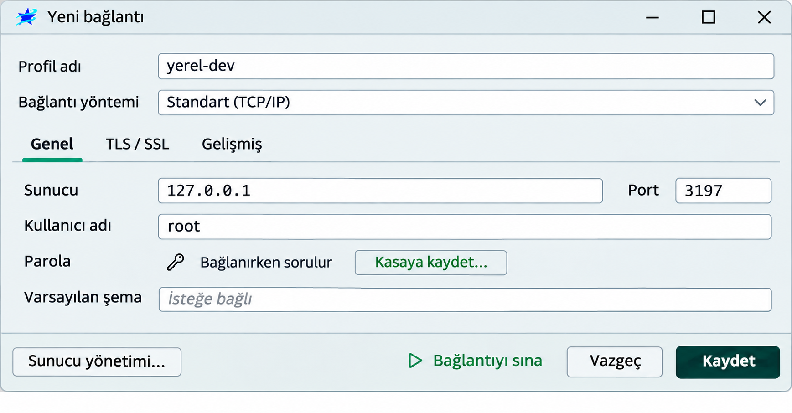
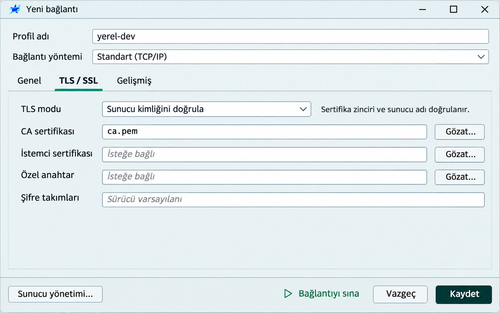
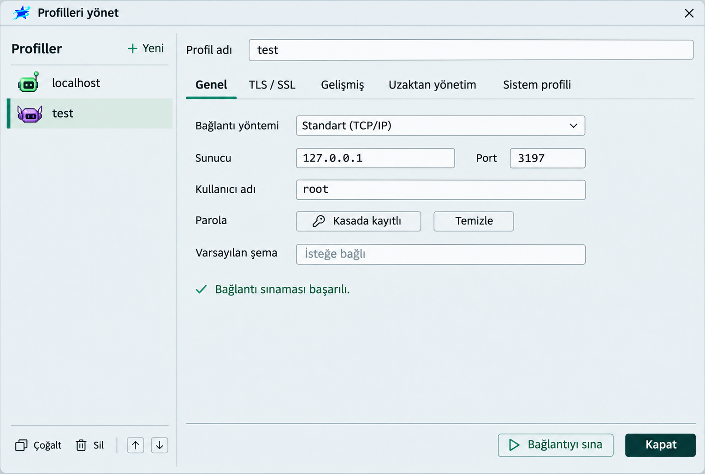
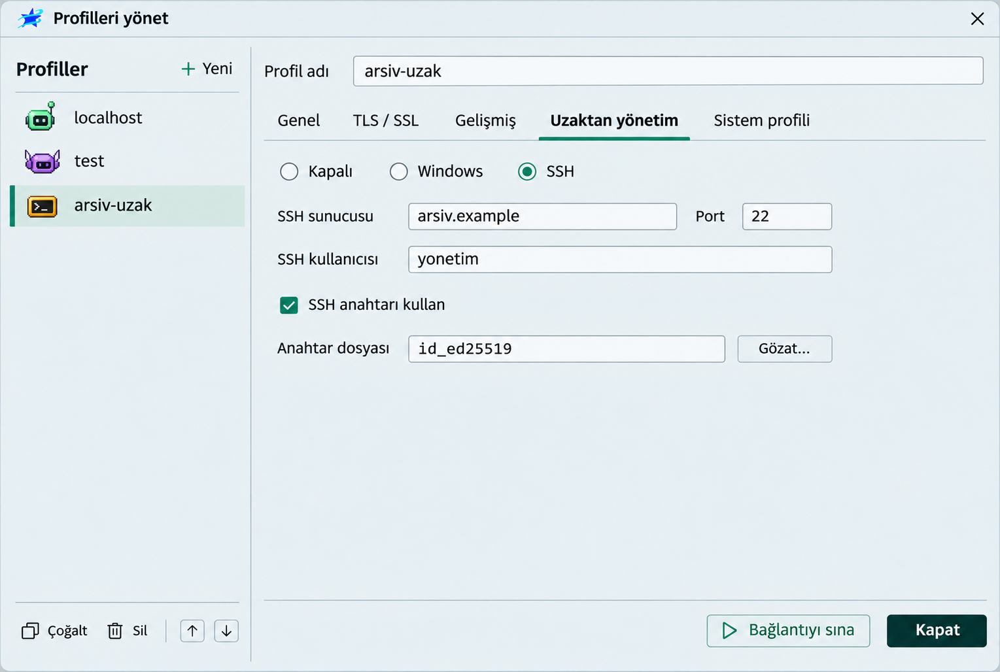
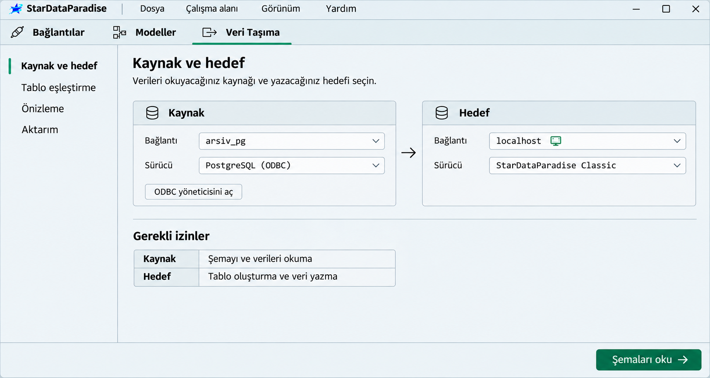
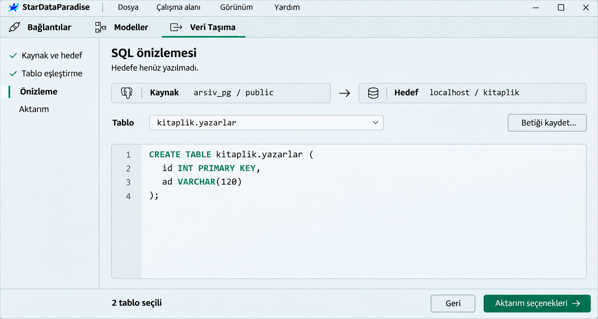

# StarDataParadise Classic · Bağlantı ve veri taşıma taslakları

19 Kasım 2026. Bu yedi PNG, üç Classic ekranının açık temadaki tasarım önerilerini gösterir. Profil adları, dosya adları ve sınama sonucu, ilgili ekran durumunu göstermek için kullanılan örneklerdir. Renkler, yazı aileleri, piksel avatarları ve eylem düğmeleri için [ana sayfanın tasarım kuralları](../ANA_SAYFA.md) esas alındı.

Kompakt bağlantı formu, profil yöneticisi ve Veri Taşıma Classic'e uygulandı. Gerçek davranışlar, derleme ve kabul kanıtları [uygulama kaydındadır](UYGULAMA.md).

| Ekran | Ana görünüm | İlgili durum |
| --- | --- | --- |
| Yeni bağlantı | [](yeni-baglanti-kompakt.png) | [](yeni-baglanti-tls.png) |
| Profilleri yönet | [](profilleri-yonet.png) | [](profilleri-yonet-ssh.png) |
| Veri Taşıma | [](veri-tasima-baslangic.png) | [](veri-tasima-sql-onizleme.png) |

Yeni bağlantının [standart boyuttaki görünümü](yeni-baglanti-standart.png), TLS görseliyle aynı pencere ölçüsündedir. Kompakt sürümde port alanı kısalır ve eylemler son form satırının hemen altında yer alır.

- **Yeni bağlantı.** Sunucu ile port aynı satırdadır. Genel bilgiler, TLS ve gelişmiş ayarlar aynı formun sekmeleridir. Parola kaydedilmemişse ne zaman sorulacağı alanın yanında görünür. **Bağlantıyı sına** ve **Kaydet** ayrı eylemlerdir.
- **Profilleri yönet.** Seçili profil soldaki avatarı ve nane renkli satırla tanınır. Genel, TLS / SSL, Gelişmiş, Uzaktan yönetim ve Sistem profili tek sekme sırasındadır. Sınama sonucu seçili profilde görünür. SSH örneğinde uzaktaki **arsiv-uzak** profili seçilidir. Çoğaltma, silme ve sıralama komutları ait oldukları listenin altındadır.
- **Veri Taşıma.** Açılış doğrudan kaynak ve hedef seçimiyle başlar. Kaynak okuma ve hedef yazma izinleri kendi satırlarında görünür. **Şemaları oku** keşif adımını açar. Önizlemede kullanıcı seçtiği tablonun SQL'ini inceler veya kaydeder. **Aktarım seçenekleri** bir sonraki adıma götürür. Hedefe yazma, aktarım aşamasındaki açık uygulama eylemidir.

Yedi PNG, özgün ImageGen çıktılarıyla SHA-256 üzerinden eşleşti. PNG bütünlük denetimi geçti ve galerideki sekiz yerel bağlantı doğrulandı. Görsel çözünürlükleri fiziksel piksel cinsindendir. Uygulama ölçüleri için tasarım kurallarındaki DIP değerleri kullanılır.

<details>
<summary>Yerleşik ImageGen ile kullanılan üretim istemleri</summary>

**Yeni bağlantı · standart boyut**

Görsel girdiler sırasıyla Kullanıcının yeni bağlantı penceresi ve [onaylı ana sayfa](../baglantilar.png).

```text
Use case: ui-mockup. Redesign the first attached image (an actual old native Turkish "Yeni bağlantı" dialog) as ONE polished, precise, production-quality, straight-on DESKTOP SOFTWARE screenshot. The second attachment is the APPROVED sibling StarDataParadise Classic style: copy its blue/cyan orbital star, typography, crisp muted Nordic blue-gray surfaces, dark green actions and compact desktop alignment. That reference supplies style only, not its home tabs or content. Present the dialog ONLY, edge to edge, with the entire thin Windows title bar and full footer visible, natural landscape 983 × 617 reference proportions (render high resolution). No browser, backdrop, card around the window, text outside the window, poster or device. Flat pixel-accurate geometry, clean, readable Turkish native lettering.

This is the moment a developer has entered a NEW saved profile, before testing. Use only this copy, with proper Turkish accents. Top title bar: tiny authentic product star followed by "Yeni bağlantı", close × at right. In the body, use a disciplined right-aligned label column and one aligned fluid input column. First row "Profil adı" with value "yerel-dev", next "Bağlantı yöntemi" with a dropdown "Standart (TCP/IP)". A compact flat text tab strip, "Genel" selected with a short teal underline, then "TLS / SSL" and "Gelişmiş".
Form aligned on that same grid: "Sunucu" value "127.0.0.1" next to a NARROW "Port" value "3197" on a single row, "Kullanıcı adı" value "root". "Parola" with a small monochrome key, the single useful status "Bağlanırken sorulur" and inline action "Kasaya kaydet…". "Varsayılan şema" is an empty field with subdued placeholder "İsteğe bağlı". End the form naturally. One compact bottom command strip, left "Sunucu yönetimi…", right a small play-outline action "Bağlantıyı sına", an outlined "Vazgeç" and a dark petroleum filled "Kaydet". One dominant action. Do not repeat title in body. Remove original right-hand boilerplate help column. Never add a success message or account/port status bar to this untested state.
Design constants: base #EDF2F4, strip #E7EEEF, charcoal teal ink #102629, secondary #4F5759, 1 DIP hairlines #A3B4BC, active underline #098874, filled save #043133 and white. Segoe UI 13 DIP, semibold for selected tab and primary, 16 DIP window heading at most, Consolas 13 for technical values. Small 26–28 DIP fields and buttons, 2 DIP corners, 12 DIP edge inset, 6–8 gaps, 8–12 DIP grouping. Scale the whole dialog to the image using one consistent scale and no oversized dead areas. No big headings, shadows, gradients, bevels, gray 90s property sheet, rounded pills, extra icons, fake OS chrome or extra copy. Draw precise Windows form controls and check each letter for legibility.
```

**Yeni bağlantı · kompakt boyut**

Görsel girdiler sırasıyla [Standart boyut](yeni-baglanti-standart.png).

```text
Use case: ui-mockup. Make a precise final density correction to this attached StarDataParadise Classic Turkish "Yeni bağlantı" screenshot. Preserve its brand star, exact Turkish labels, fields and values, choices, turquoise accent, readable native fonts, command order and overall native Windows treatment. Produce one complete, front-facing screenshot with a visibly SHORTER physical dialog, native working size about 740 × 365 DIP (landscape ratio about 2:1), export around 1760 × 875. Fill the entire image with this one window. There must be literally only 8–12 DIP between the last field and the footer divider, at most HALF of one input height. Shorten the dialog itself; never keep a tall empty panel under the form. Maintain comfortable 26 DIP field/button height and an even 6 DIP vertical gap rather than stretching controls to fill that gap. Without any outer outline around the group, keep a single fine hairline below the tabs.
Fix the host/port row visibly: wide host text box "127.0.0.1" takes all remaining width, followed on the far right by label "Port" and a deliberately SHORT 70 DIP wide text box, just sufficient for five numerals, holding "3197". Do not give the port a third of the row. Align every textbox to the same grid. "Parola": key glyph and plain status "Bağlanırken sorulur" displayed as text, no border around that status, followed by a separate thin secondary button "Kasaya kaydet…".
All other visible text verbatim: title "Yeni bağlantı"; "Profil adı" / "yerel-dev"; "Bağlantı yöntemi" / "Standart (TCP/IP)"; tabs "Genel" selected, "TLS / SSL", "Gelişmiş"; "Sunucu"; "Kullanıcı adı" / "root"; "Varsayılan şema" / "İsteğe bağlı". Footer left "Sunucu yönetimi…", footer right "Bağlantıyı sına" with thin play icon, "Vazgeç", dark petroleum primary "Kaydet". Use 12 DIP outer margin, no blank canvas or whitespace around the window. Crisp 13 DIP Segoe UI and Consolas for endpoint numbers. Keep 1 DIP rules, flat #EDF2F4 body, #E7EEEF bars, #A3B4BC separator, #098874 active tab, #043133 save. Small form content actually uses the vertical space, with the footer tucked up just below the last row. Preserve every label and diacritic, no new text, extra decoration, shadows, afterthought captions or filler.
```

**Yeni bağlantı · TLS / SSL**

Görsel girdiler sırasıyla [Standart boyut](yeni-baglanti-standart.png) ve kullanıcının yeni bağlantı penceresi.

```text
Use case: ui-mockup. Edit the FIRST attached Turkish Windows desktop dialog to show the TLS / SSL tab of that very same StarDataParadise Classic new connection flow. The second attachment is the predecessor for functional context only. Same one window as image 1, natural 983 × 617 landscape proportions rendered high resolution, front-on edge to edge. Keep exactly the first image's small cyan orbit star, "Yeni bağlantı" title, native title controls, "Profil adı" = "yerel-dev", "Bağlantı yöntemi" = "Standart (TCP/IP)", the three positions of the tabs "Genel", "TLS / SSL", "Gelişmiş", and the entire slim footer with "Sunucu yönetimi…", "Bağlantıyı sına", "Vazgeç", "Kaydet". Keep the baseline grid and visual DNA. Switch the active dark teal 2 DIP underline from Genel to "TLS / SSL"; Genel becomes inactive and not bold.
Change only the body of the tab to a compact certificate form, LABEL column at left, value and file chooser at right. Row 1 "TLS modu" dropdown "Sunucu kimliğini doğrula". Row 2 "CA sertifikası", monospaced file name "ca.pem", small outlined "Gözat…" aligned to the right. Row 3 "İstemci sertifikası", light placeholder "İsteğe bağlı", same "Gözat…". Row 4 "Özel anahtar", light placeholder "İsteğe bağlı", same "Gözat…". Row 5 "Şifre takımları", empty field with placeholder "Sürücü varsayılanı". Small note tied to TLS mode, once: "Sertifika zinciri ve sunucu adı doğrulanır." No general tab fields in this body: host, port and password stay on Genel. Do not add warnings, passed tests, admin badges or any actual keys or passwords. Use a tidy 6–8 DIP vertical rhythm, 12 DIP side inset, 26 DIP high controls, thin slate hairlines and nearly square input boxes. Keep the settings and footer visually cohesive with a modest bottom gap, no gratuitous whitespace. Segoe UI 13 DIP for labels, Consolas 13 for ca.pem, exact Turkish spelling, light surface #EDF2F4, strip #E7EEEF, ink #102629, teal underline #098874, dark petroleum save #043133 white text. Maximum fidelity to the first frame's native desktop design, no gradients, cards, illustration, glass, floating panel, poster, split comparison or extra copy.
```

**Profilleri yönet · genel**

Görsel girdiler sırasıyla Kullanıcının bağlantı yöneticisi ve [onaylı ana sayfa](../baglantilar.png).

```text
Use case: ui-mockup. Redesign the FIRST attached image, the old "Manage Server Connections" Windows dialog, into ONE realistic, high-resolution screenshot of the StarDataParadise Classic Turkish profile manager. SECOND attachment is the approved StarDataParadise home style reference; closely match its pale blue-gray desktop UI, little cyan/blue orbit star, platinum hairline dividers, 20 DIP mint antenna CRT and plum twin-ear pixel avatars, Segoe UI and Consolas. This is desktop software for a developer. Use the natural 1111 × 747 window ratio of the first reference, front-on edge to edge, one window only, all content including footer, no surrounding desktop, product tour, captions or decorative collage. Realistic compact form rather than web dashboard.

Title bar: tiny branded orbital star and "Profilleri yönet", Windows close ×. The canvas is split by one slim vertical rule at roughly 23%. Left pane heading "Profiller", a small text action "+ Yeni"; exactly two list rows: mint pixel avatar and "localhost"; purple pixel avatar and "test". Select ONLY "test" with full-width muted mint row and narrow dark teal leading rule. Small low-emphasis tools below list: "Çoğalt" with overlapping sheets, "Sil" with bin and small up/down line arrow buttons for reordering. One row per saved profile, no cards, no online status dots.
Right pane begins with a horizontal labeled editable text field "Profil adı" showing "test". Below it only ONE level of compact flat property tabs: "Genel", "TLS / SSL", "Gelişmiş", "Uzaktan yönetim", "Sistem profili". Select "Genel" with a 2 DIP teal underline. In the aligned detail form: "Bağlantı yöntemi" dropdown "Standart (TCP/IP)"; "Sunucu" "127.0.0.1" and narrow "Port" "3197" side by side; "Kullanıcı adı" "root"; "Parola" with small key, "Kasada kayıtlı" and "Temizle"; "Varsayılan şema" empty, placeholder "İsteğe bağlı". Below form, ONE quiet inline checkmark beside the exact message "Bağlantı sınaması başarılı." This is specifically the example state after testing. Footer right: play-outline "Bağlantıyı sına" and a dark petroleum primary "Kapat". No second save button. Keep the unused central area calm; size groups to content and avoid exaggerated top or side padding.
Match the shared UI system exactly: #EDF2F4 base, #E7EEEF strips, #102629 text, #4F5759 muted, #A3B4BC dividers, #DDEBE4 selected list, #098874 active marker, #043133 primary with white. Label/control 13 DIP Segoe UI, technical strings 13 DIP Consolas, 26 DIP high controls, 32 DIP profile rows, 12 DIP outer inset and 4/6/8 DIP inner spacing. Crisp 1.5 DIP monochrome outline command glyphs; only the two tiny profile avatars are pixel art. Thin input outlines and nearly square 2 DIP corners. No padding-heavy web cards, bevels, stock blue tab widgets, shadow, gradient, giant type, boilerplate paragraphs, duplicate endpoint indicator, English labels or unrequested features. Clear, correct Turkish lettering, level baselines.
```

**Profilleri yönet · uzaktan yönetim**

Görsel girdiler sırasıyla [Genel görünüm](profilleri-yonet.png) ve kullanıcının bağlantı yöneticisi.

```text
Use case: ui-mockup. The FIRST attached screenshot is the exact visual target. Produce a sibling state of that same StarDataParadise Classic profile manager, with the remote administration tab selected for a separate remote sample profile. The SECOND attachment is the older application for functional reference only. Same natural 1111 × 747 desktop window aspect ratio, full bleed, one flat screenshot, same little orbit star, exact "Profilleri yönet" title and native close control, same left rail, baselines, shared footer and typography as first image. Not a new design direction.
In the left "Profiller" list keep the mint pixel bot "localhost" and violet bot "test" as unselected rows; add a third real-looking saved sample "arsiv-uzak" with a tiny muted amber original pixel terminal avatar. Select ONLY the third row with the mint fill and slim vertical teal mark. Above: "+ Yeni". Bottom left unchanged "Çoğalt", "Sil", up/down icon buttons. Right profile field "Profil adı" contains "arsiv-uzak". Keep a single flat row "Genel", "TLS / SSL", "Gelişmiş", "Uzaktan yönetim", "Sistem profili". Underline ONLY "Uzaktan yönetim". Do not repeat that tab name as a heading.
Replace the general DB settings with the SSH management form. One dense row of three native radio choices labeled "Kapalı", "Windows", "SSH": exactly one filled radio dot at SSH. Then labeled fields "SSH sunucusu" value "arsiv.example", narrow "Port" value "22" on the same line; "SSH kullanıcısı" value "yonetim"; a checked native square checkbox "SSH anahtarı kullan"; "Anahtar dosyası" with monospaced "id_ed25519", one "Gözat…" button beside it. No visible secret values and no made-up connection-test outcome. Retain the normal footer right "Bağlantıyı sına" and primary "Kapat". Keep edits associated only with arsiv-uzak. Other tabs' contents stay hidden. No extra panels, new features, shadows or marketing copy, no blue legacy styling. Dialog has restrained air after the keyboard-friendly form but close spacing between adjacent controls. Existing muted #EDF2F4 surface and #E7EEEF bars, #102629 ink, #DDEBE4 selection, #098874 marker, #043133 primary, white primary text. 13 DIP Segoe UI, Consolas identifiers, crisp thin rules, 26 DIP buttons, 2 DIP radius, 12 DIP outer inset. Every Turkish letter readable.
```

**Veri Taşıma · kaynak ve hedef**

Görsel girdiler sırasıyla Kullanıcının veri taşıma başlangıç ekranı ve [onaylı eşleştirme ekranı](../veri-tasima.png).

```text
Use case: ui-mockup. Redesign the FIRST attached screenshot (existing StarDataParadise migration start screen) in the design of the SECOND attached approved migration workbench (style and persistent shell only). ONE realistic pixel-sharp Turkish Windows desktop software screenshot, an actionable migration start screen. Use edge-to-edge wide landscape proportions of 1918 × 1018, normal Windows title and controls fully visible. The new state is BEFORE schema discovery or SQL execution. Melt the old wall of text into the actual first task, choosing source and target. No standalone poster, scene or annotations.

Reproduce the exact shell from the approved second image: blue/cyan orbit star, "StarDataParadise", slim divider, "Dosya", "Çalışma alanı", "Görünüm", "Yardım", window controls. Second slim navigation strip with line icons "Bağlantılar", "Modeller", "Veri Taşıma" (only Veri Taşıma active with short teal underline). Under that, 176 DIP step rail on left: "Kaynak ve hedef" currently active with a teal stripe, then "Tablo eşleştirme", "Önizleme", "Aktarım". All future steps plain, uncompleted. NO big blue tree of tiny steps and NO second sidebar.

Right workspace: modest heading "Kaynak ve hedef". One short useful sentence "Verileri okuyacağınız kaynağı ve yazacağınız hedefi seçin." An integrated horizontal workspace table, two equal columns on one shared baseline: "Kaynak" at left with a small database glyph, "Hedef" at right with a small database glyph, a single clear left-to-right outline arrow between. Independent, compact, realistic dropdown fields, not ornamental cards. Source field labels "Bağlantı" / "Sürücü", values "arsiv_pg" / "PostgreSQL (ODBC)". Target fields "Bağlantı" / "Sürücü", values "localhost" / "StarDataParadise Classic". Tiny mint pixel CRT immediately beside the saved target profile if used. Under the source only, a secondary action "ODBC yöneticisini aç". Below the paired selectors, a single quiet divider followed by "Gerekli izinler" and exactly two compact aligned entries: "Kaynak" — "Şemayı ve verileri okuma"; "Hedef" — "Tablo oluşturma ve veri yazma". Place these controls high in the workspace, not as a giant centered hero. Bottom footer: rightmost ONE deep green primary button "Şemaları oku" with a right arrow. Leave the status area quiet. No start transfer button, no progress percentage, no success badge, no account/server-port HUD, no fake app features or times. The image depicts the first step; do not copy the reference's mapping table or third-stage SQL.
Native design rules: Segoe UI 13 DIP text, semibold 16 DIP headings, Consolas 13 DIP technical strings, 1 DIP #A3B4BC hairlines, no gradients or shadows. Base #EDF2F4, strips #E7EEEF, ink #102629, secondary #4F5759, accent #098874, primary green #096E56 white. Compact 26 DIP buttons, 32 DIP fields or rows, 2 DIP corners and a 12 DIP margin. Scale the artboard as one coherent native application. Deliberate restrained whitespace, readable Turkish characters, close alignment and purposeful form density.
```

**Veri Taşıma · SQL önizlemesi**

Görsel girdiler sırasıyla [Kaynak ve hedef](veri-tasima-baslangic.png) ve [onaylı eşleştirme ekranı](../veri-tasima.png).

```text
Use case: ui-mockup. Edit FIRST attachment into the SQL preview stage of the SAME native Turkish StarDataParadise Classic migration workbench. SECOND attachment is the approved preceding table-mapping stage (it supplies the exact example database and table names), not the active screen. ONE pixel-sharp screenshot, entire desktop window edge to edge, same wide 1918 × 1018 reference aspect, no external canvas or framing. Keep top chrome, brand colors, scale, left rail and typography exactly like first image. Top shell star + "StarDataParadise" + "Dosya", "Çalışma alanı", "Görünüm", "Yardım"; next strip "Bağlantılar", "Modeller", "Veri Taşıma" active. At left "Kaynak ve hedef" and "Tablo eşleştirme" complete (small teal checks), "Önizleme" active (teal vertical rule), "Aktarım" still pending. Keep only this rail.
Right workspace now titled "SQL önizlemesi". Beside or beneath this heading a compact plain status "Hedefe henüz yazılmadı." One compact source-to-target strip: "Kaynak" then monospaced "arsiv_pg / public", a small right arrow, "Hedef" then "localhost / kitaplik". One row "Tablo" with a dropdown containing the exact identifier "kitaplik.yazarlar"; on the right a single low-emphasis action "Betiği kaydet…". Below, one wide native read-only code editor, subtle thin border, very light surface, pale line-number gutter, accurate 13 DIP Consolas, muted teal SQL keywords. Display just this short and syntactically correct four-line SQL with punctuation and indentation:
CREATE TABLE kitaplik.yazarlar (
    id INT PRIMARY KEY,
    ad VARCHAR(120)
);
Place the line numbers 1, 2, 3, 4 in the gutter, not in the query. Do not invent more SQL, extra quote characters, nonsense data, English UI copy or lorem ipsum. The target is a CREATE TABLE preview; the title and SQL should be legible at normal size. Footer of workspace "2 tablo seçili" on the left, outlined "Geri" and green primary "Aktarım seçenekleri" with a right arrow on the right. The primary advances to configuration, not execution; no Run button, progress, success state or fake data already copied.
Strict look: #EDF2F4 cool gray base, #E7EEEF command bars, #102629 text, #4F5759 secondary, #A3B4BC thin dividers, #098874 selected tab, #096E56 with white for forward. 13 DIP Segoe UI labels, 16 DIP compact heading, 26 DIP controls, 2 DIP radius, thin monochrome 1.5 DIP desktop icons. Tight 12 DIP outside margin, 4–8 DIP between related items. No other labels or illustrations, dashboard cards, mockup annotation, decorative gradient or giant whitespace between form controls. Use existing space for the code editor. Preserve authentic Turkish typography and accents.
```

</details>
