# Canlı inceleme kaydı

19 Kasım 2026. Windows Classic Release_OSS x64. Kaynak HEAD `dc3590dbfbee29c87e201d4ef53607e5deb0e4f9` ve mevcut yerel yama incelendi. %125 masaüstü ölçeğinde 1482×970 ve büyütülmüş 1920×1020 görüntüler kullanıldı.

[Galeri](README.md) · [Komut eşleştirmeleri](KOMUTLAR.md)

24 ekran kaydı bu çalışmada alındı. Şema ve tablo bağlam menülerinin metin ağaçları da kaydedildi. Sayfa 37–41 ve beş entegrasyon önerisinin alanları ayrıca kaynaktan çıkarıldı.

## Gözlenen akış

### 1. SQL başlangıcı

**İyileştirme gerekli.** Çalışma alanının büyük bölümü yardımın kapalı durum metnine ayrılıyor. SQL komutları iki araç çubuğunda dağılmış. 01,05,06 taslakları bu yerleşimi ele alıyor.

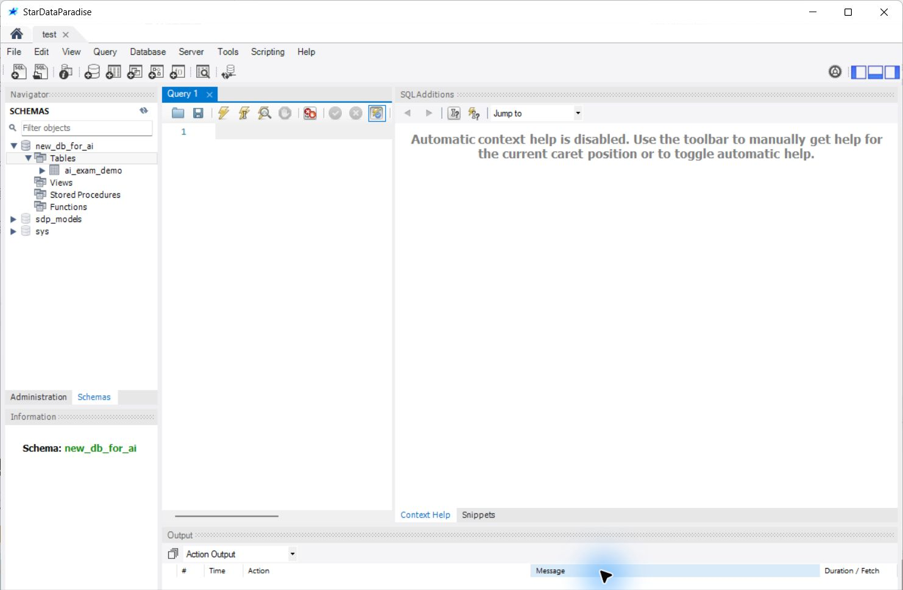

### 2. Sunucu menüsü

**İyileştirme gerekli.** Temel yönetim ile eklentiye bağlı kurumsal girişler aynı listede. Menüdeki komutlar kaynak kayıtlarıyla eşleştirildi.

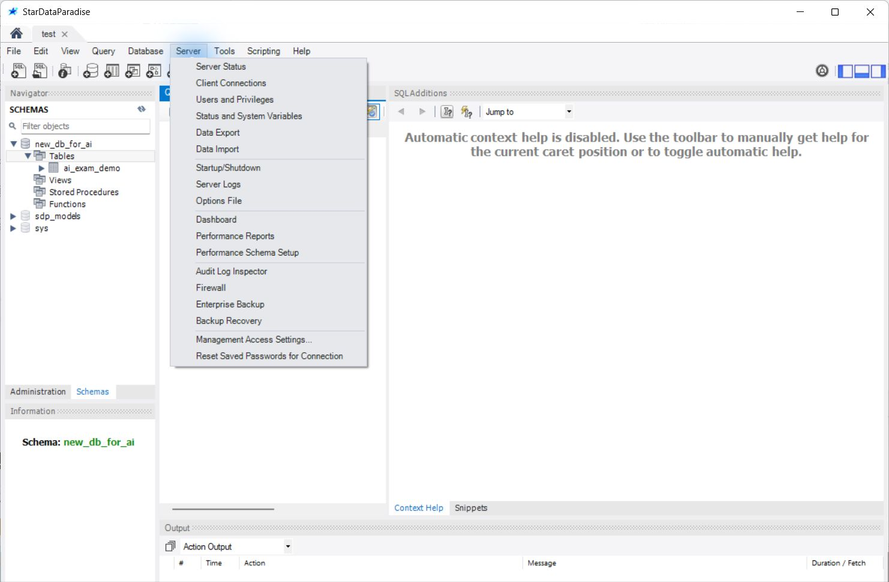

### 3. Sunucu durumu

**Açıldı.** Sürüm, durum, bağlantılar ve kaynaklar okundu. Eski MySQL görseli ve geniş yüzeyler görülüyor. 12 taslağı bu içeriği yeniden yerleştiriyor.

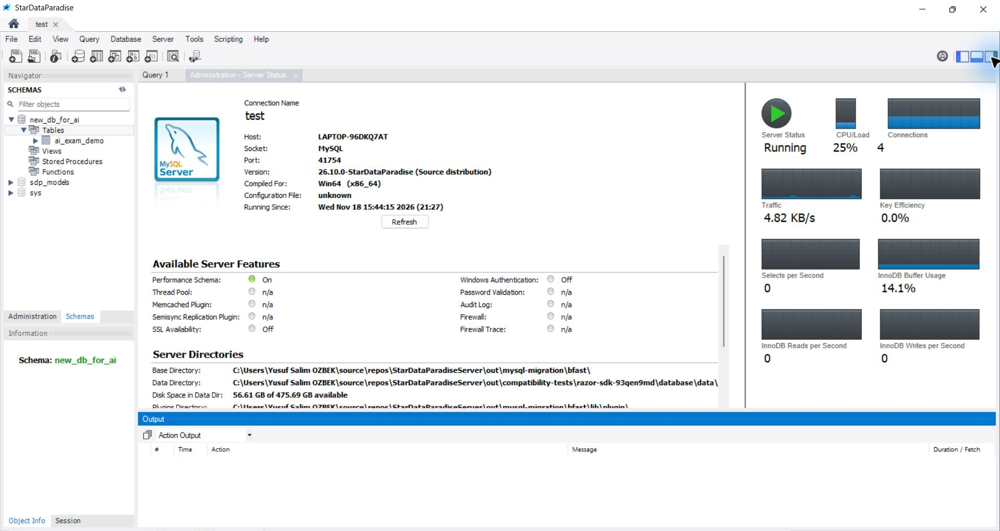

### 4. İstemci oturumları

**Açıldı.** İşlem tablosu, yenileme seçimi, uyuyanları gizleme ve iki ayrı iptal/sonlandırma eylemi var. Sonlandırma işlemi denenmedi.

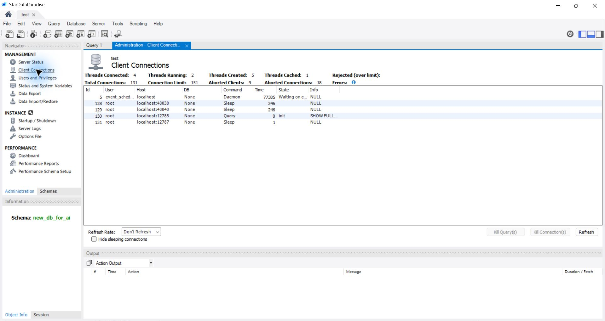

### 5. Kullanıcılar ve yetkiler

**Açıldı.** Hesap listesi ve dört alt sekme gözlendi. Hesap ve yetki değişikliği yapılmadı. Uzun açıklamalar kompakt formda yeniden düzenleniyor.

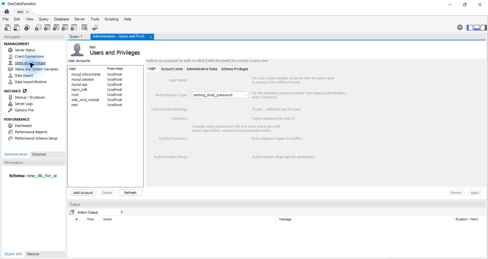

### 6. Sayaçlar ve değişkenler

**Açıldı.** Tümü kategorisi seçilince veriler göründü. Kategori seçilmemiş ilk görünüm boş kalıyor. 15 taslağında varsayılan kategori açıkça seçili.

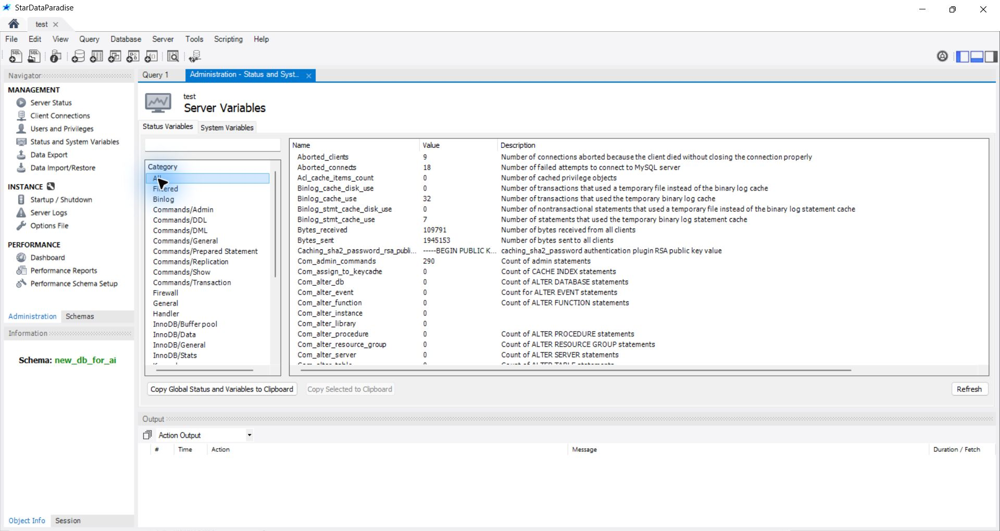

### 7. SQL dışa aktarma

**Açıldı.** Şema/tablo seçimi, dump seçenekleri ve dosya/klasör modları gözlendi. Çıktı alanı sayfanın alt seçeneklerini daraltıyor.

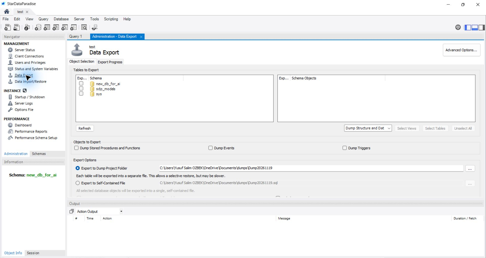

### 8. SQL içe aktarma

**Açıldı.** Dosya/klasör ve hedef şema alanları gözlendi. Aktarım başlatılmadı. Hedef özeti 20 taslağında açıkça gösteriliyor.

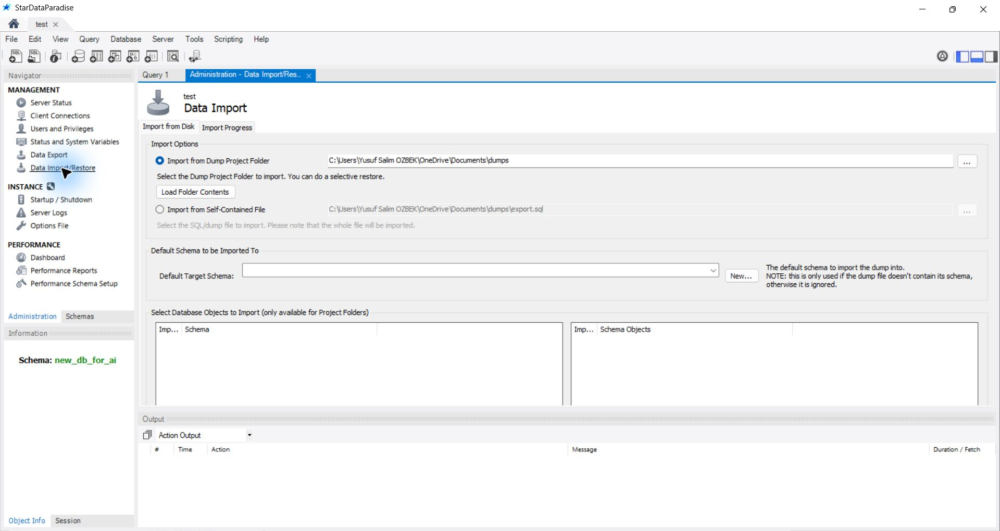

### 9. Hizmet yönetimi

**Önkoşul sorunu.** Kayıtlı hizmet adı boşken MySQL adı varsayıldığını söyleyen günlük görüldü. Başlat/durdur denenmedi. 21 taslağı profil eşleştirme durumunu gösteriyor.

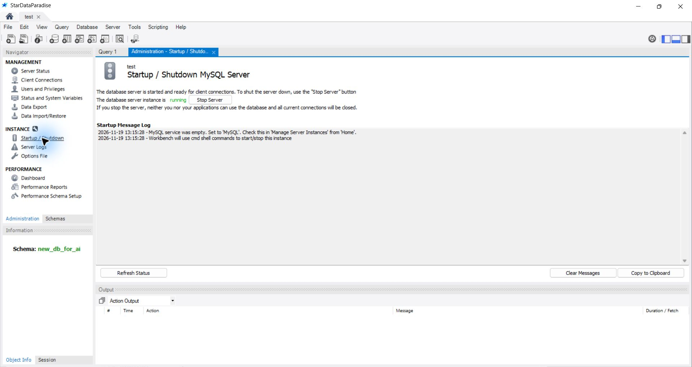

### 10. Sunucu günlükleri

**Yapılandırma yolu gerekli.** Sayfa, sunucu seçenek dosyası yolu eksik mesajında kaldı. Günlük içeriği için native okuyucu ve kontroller kaynakta incelendi.

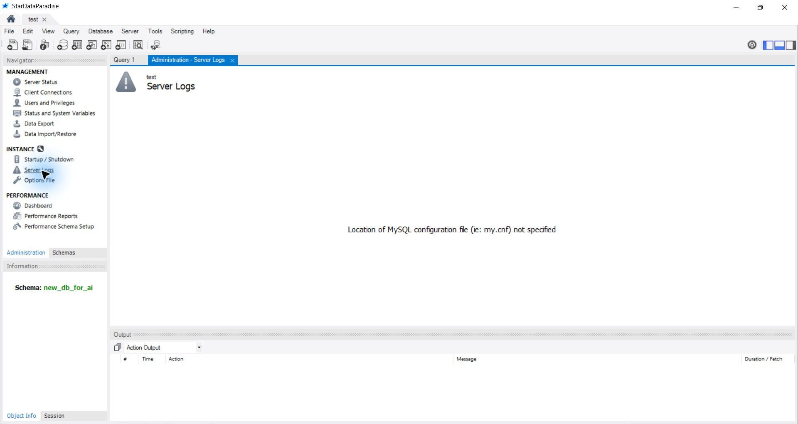

### 11. Seçenek dosyası

**Yapılandırma yolu gerekli.** Dosya yolu olmadığı için form açılamadı. İçerik ve kategori yapısı kaynaktan incelendi.

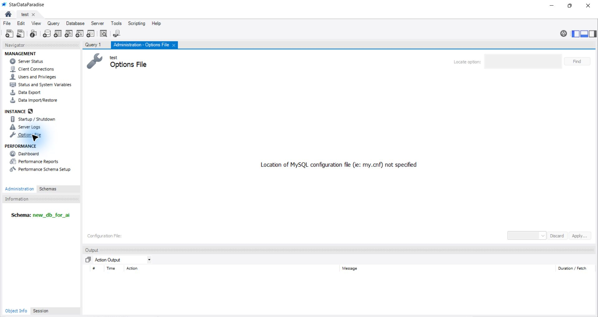

### 12. Canlı performans

**Açıldı.** Ağ, SQL ve InnoDB ölçümleri gözlendi. Grafik ve halka yoğunluğu 16 taslağında üç zaman serisi alanına dönüştürülüyor.

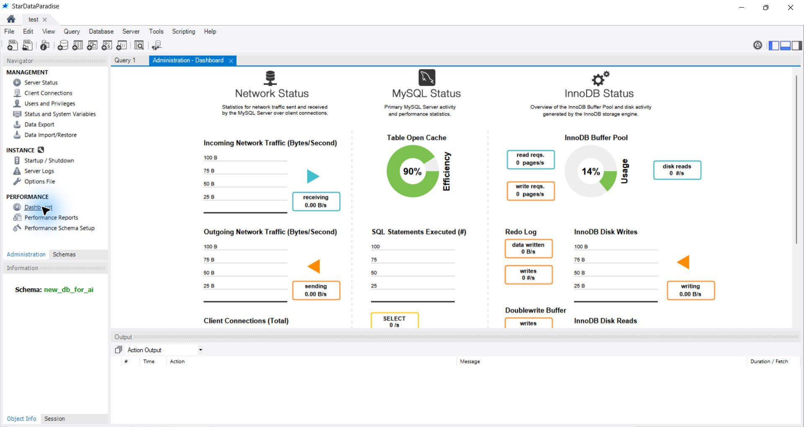

### 13. Performans raporları

**Açıldı.** Statement Analysis raporu gerçek verilerle yüklendi. Çok geniş sütunlar ve tekrar eden alan başlıkları 17 taslağında düzenleniyor.

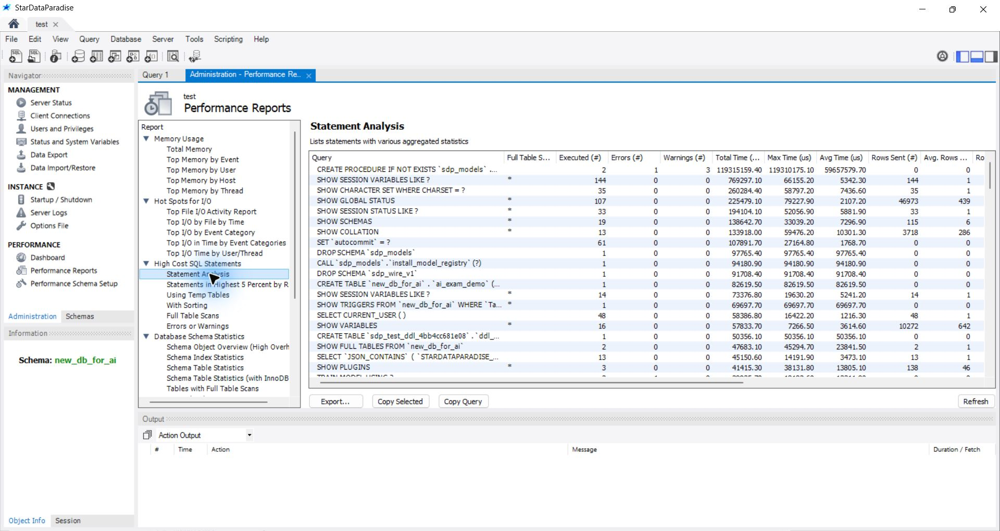

### 14. Ölçüm ayarları

**İçerik doğrulanamadı.** Sayfa başlığından sonra içerik boş kaldı. Bunun nedeni bu incelemede belirlenmedi. 18 taslağının alanları native instrumentation kaynağından alındı.

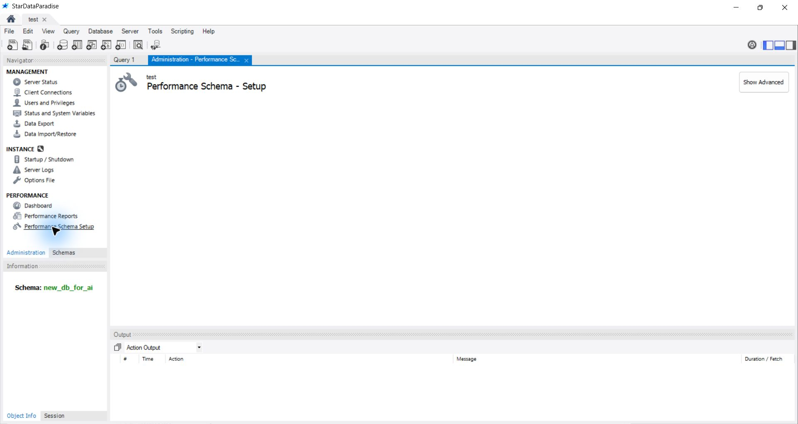

### 15. Şema inceleyicisi

**Açıldı.** Genel, tablo, sütun, indeks, tetikleyici, görünüm, yordam, fonksiyon, yetki ve event alt yüzeyleri görüldü.

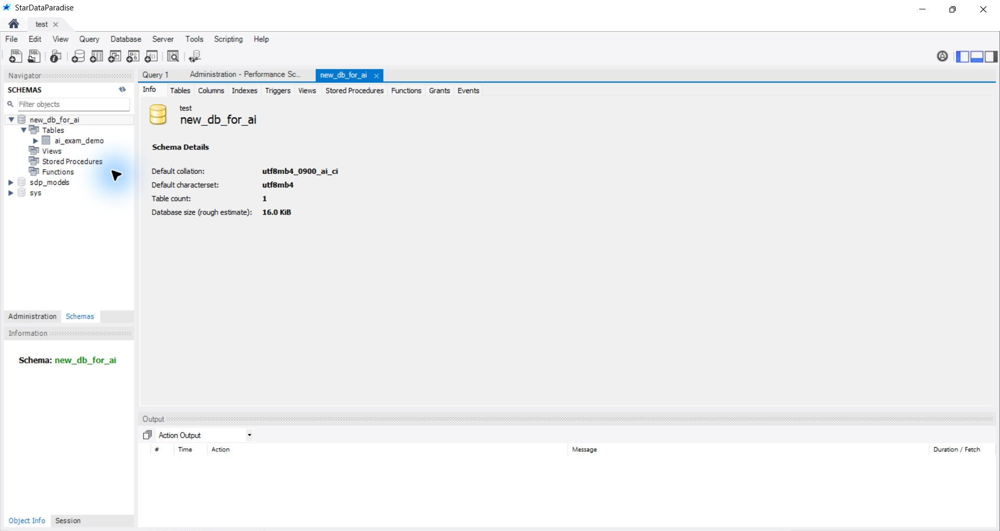

### 16. Tablo inceleyicisi

**Açıldı.** Metadata ve tahmini satır/boyut alanları okundu. ANALYZE eylemi çalıştırılmadı.

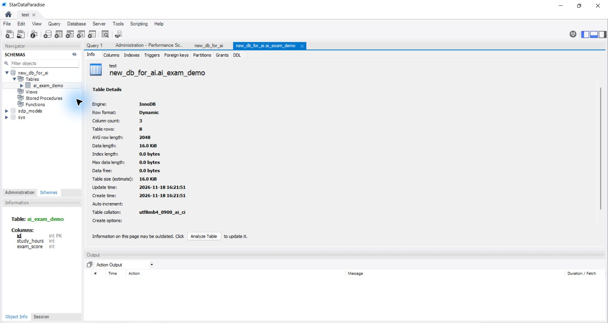

### 17. Tablo tanımı

**Açıldı.** Üç sütun, bağımsız bayraklar ve sütun/indeks/FK/tetikleyici/bölümleme/seçenek sekmeleri gözlendi. Tanım değiştirilmedi.

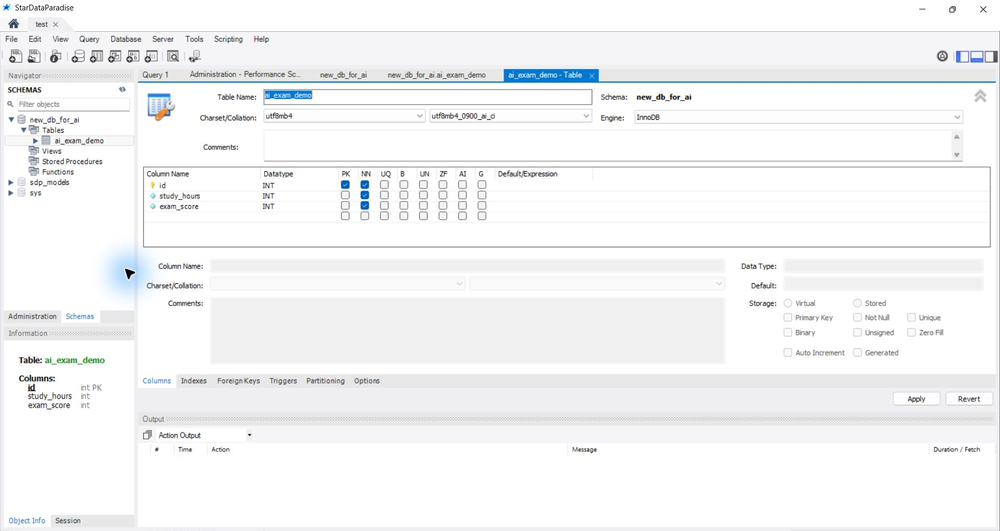

### 18. Veri araması

**Açıldı.** Eşleme yöntemi, iki ayrı satır sınırı ve bütün türleri arama seçeneği var. Veri araması başlatılmadı.

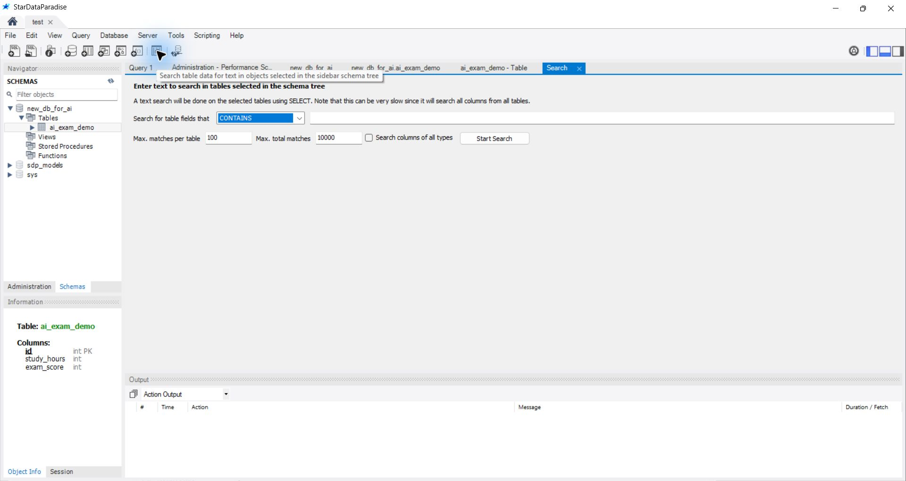

### 19. Tercihler

**Açıldı.** Kategori ağacı ve düzenleyici alanları gözlendi. Cancel ile kapatıldı. 24 taslağı ortak form ailesini gösteriyor.

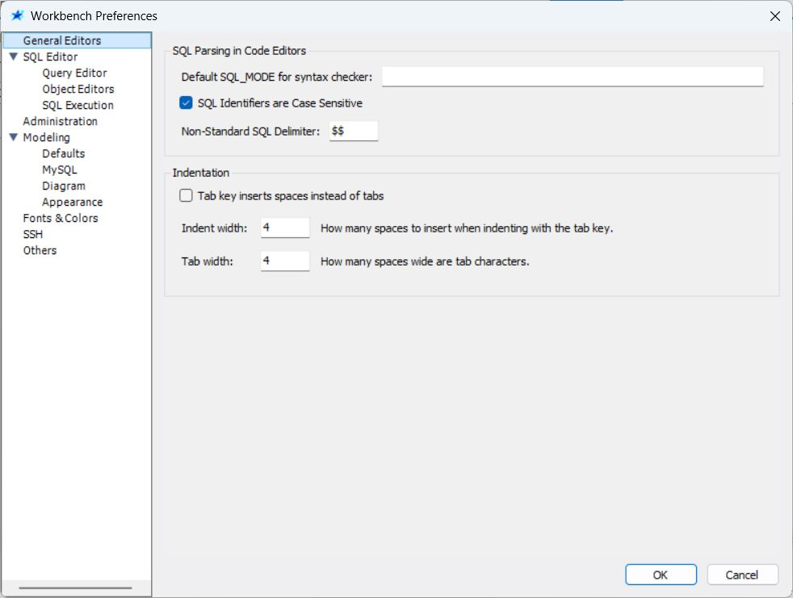

### 20. Yerel sorgu geçmişi

**Açıldı.** Tarih listesi ve SQL kayıt alanı gözlendi. Bu geçmiş ile sunucudaki veri revizyonları ayrı veri kaynaklarına sahip.

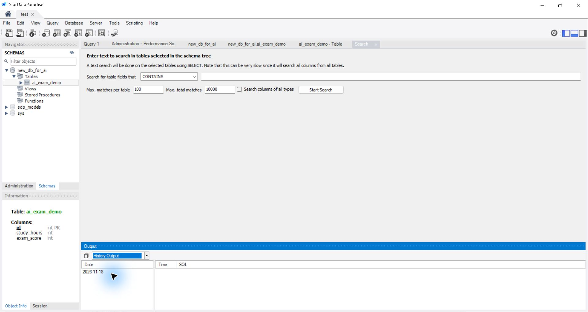

### 21. Python/GRT betik alanı

**Açıldı.** Betik dosyaları, modül ağacı ve Python konsolu görüldü. Betik çalıştırılmadı. Pencere kapatıldı.

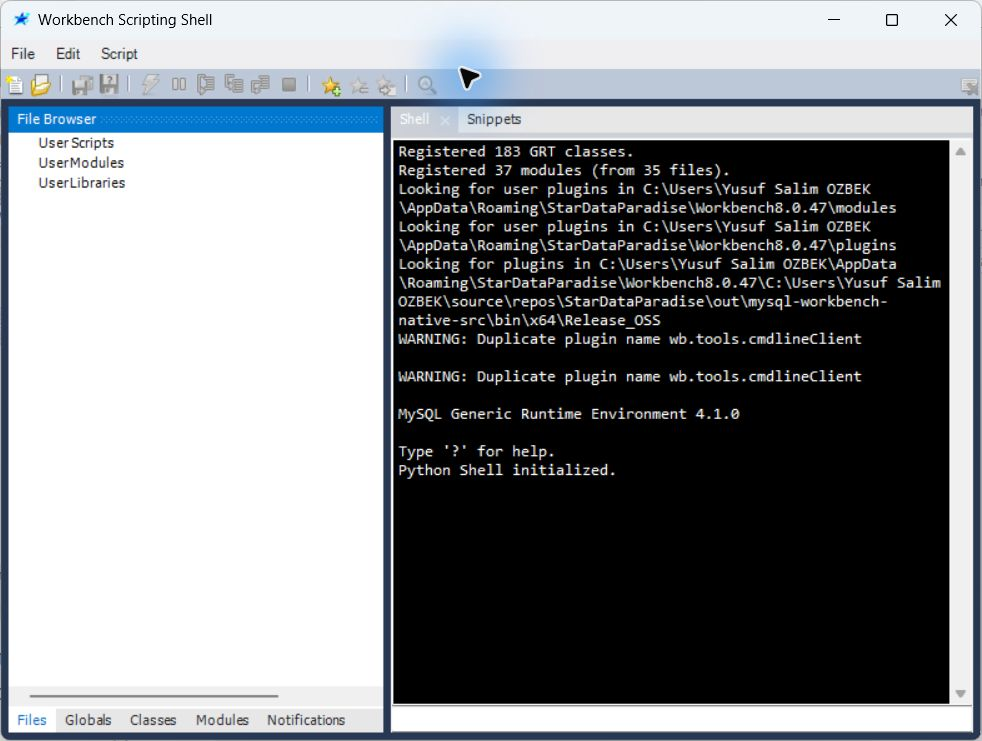

### 22. Sonuç kümesi

**Salt okunur sorgu geçti.** Yalnız sabitlerden oluşan SELECT/UNION sorgusu iki örnek satır döndürdü. Sonuç araçları ve salt okunur işareti gözlendi.

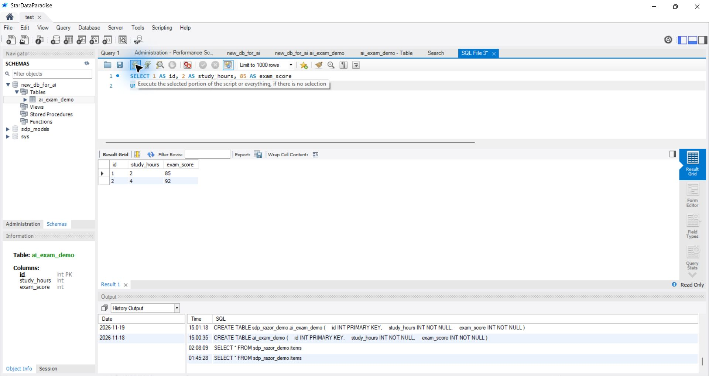

### 23. Plan görünümü

**EXPLAIN geçti.** Aynı salt okunur ifade için plan sonucu geldi. Yeni SQL tamponu inceleme örneği olarak oturumda kaldı.

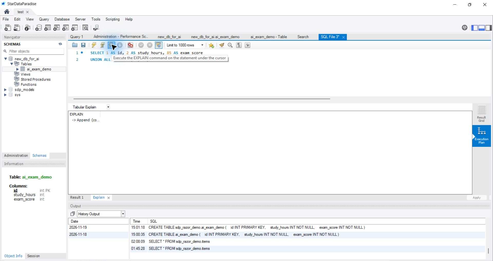

### 24. SQL parçaları

**Boş durum açıldı.** Kategori seçicisi ve ekle/değiştir komutları gözlendi. Mevcut kütüphane boş göründü. Yeni parça kaydedilmedi.

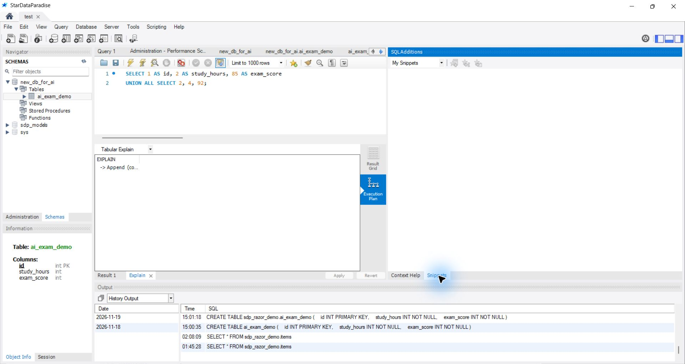

## Erişilebilirlik ve doğrulama sınırları

Görüntüler dar tıklama hedefleri, yalnız ikonla sunulan komutlar, yüksek yazı boyutu farkı ve boş yardımcı panellerin alan tüketimini gösteriyor. Yeni taslaklar ikon yanında gerekli metni, seçimi renk yanında yazı/çizgiyle ve odak görünürlüğünü öngörüyor. Ekran okuyucu uyumluluğu, klavye ile tüm sayfa dolaşımı, yüksek kontrast ve tam DPI matrisi bu tasarım incelemesinde kabul testinden geçirilmedi.

Bu etapta derleme çalıştırılmadı. Üretilenler görsel taslaklar, davranış eşleştirmeleri ve yerleşim kurallarıdır. Canlı sunucuda kontrol edilen yürütmeler sabit SELECT ve EXPLAIN ile sınırlıdır. Önceki bağlantı ve taşıma kabul kayıtları kendi etap belgelerinde bulunur.

İlk pencere konum değişimi ve güncel olmayan erişilebilirlik indeksleriyle girişler yeniden gözlem alınarak düzeltildi. Bir görüntü Codex penceresini gösterdiği için kanıt olarak kaydedilmedi. Sonraki hedef seçimi ve büyütülmüş görünümle inceleme sürdü. İki günlük sayfasının eksik ayarı ve boş ölçüm sayfası yukarıda ayrıca belirtilmiştir.

Help dış bağlantı hedefleri kullanıcının son isteğiyle ertelendi. Bu durum bir erişim hatası olarak raporlanmaz.
