# Sayfa tasarımları ve akışları

[Galeriye dön](README.md). Her görsel tek bir sayfa veya durumu gösterir. Sekmeler ve alt durumlar aynı sayfanın bileşenlerini kullanır.

## 01 · SQL çalışma alanı

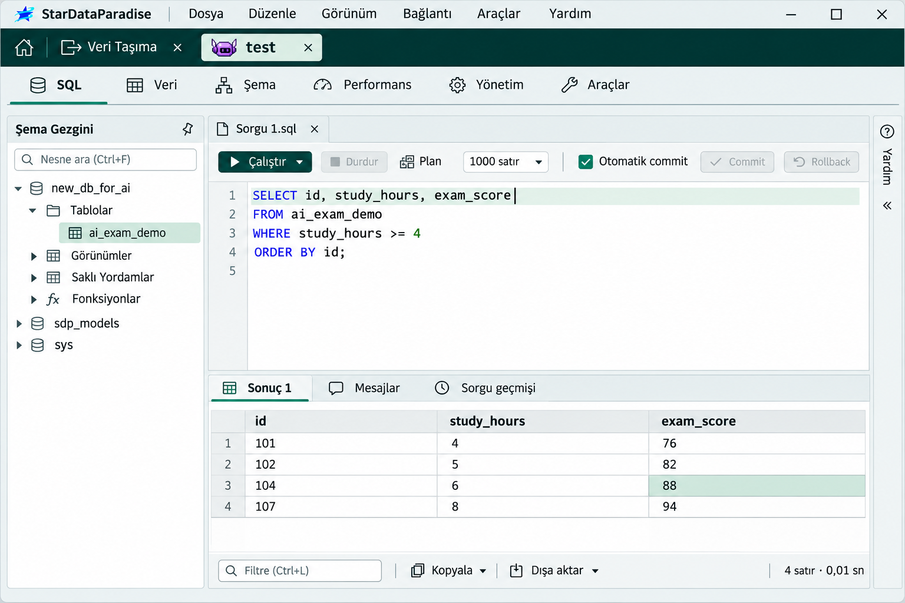

Giriş yolu `test → SQL`. SQL yazma, seçili ifade veya betik yürütme, sonuç ve mesajları izleme.

Görünen komutlar Çalıştır, İmleçteki ifadeyi çalıştır, Durdur, Plan, satır sınırı, Commit, Rollback. Ana eylem **Çalıştır**.

Boş tampon, çalışan sorgu, hata konumu, çoklu sonuç, bağlantı kaybı. Aynı bağlantının sorgu sekmeleri işlemi paylaşır.

[Mevcut kaynak](<C:/Users/Yusuf Salim OZBEK/source/repos/StarDataParadise/out/mysql-workbench-native-src/backend/wbprivate/sqlide/wb_sql_editor_panel.cpp>) · [İlgili canlı inceleme](referanslar/mevcut/01-sql-editor.jpg)

## 02 · Veri tablosu ve hücre ayrıntısı

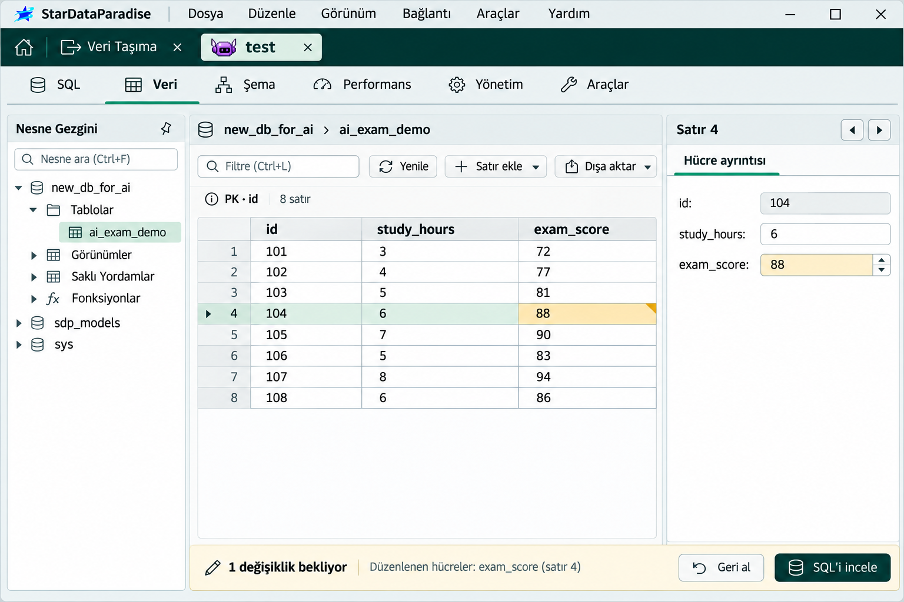

Giriş yolu `Veri → tabloyu aç`. Anahtarı olan bir sonuç kümesindeki satırları inceleme ve değişiklik taslağı hazırlama.

Görünen komutlar Filtre, Yenile, Satır ekle, Kopyala, Dışa aktar, Hücre ayrıntısı, Geri al. Ana eylem **SQL’i incele**.

Anahtar bulunmadığında düzenleme nedeni gösterilir. NULL, boş metin ve boş binary ayrı değerlerdir. BIGINT ve DECIMAL metin hassasiyetini korur.

[Mevcut kaynak](<C:/Users/Yusuf Salim OZBEK/source/repos/StarDataParadise/out/mysql-workbench-native-src/plugins/wb.sqlide/sqlide_resultset_ext.py>) · [İlgili canlı inceleme](referanslar/mevcut/24-query-results.jpg)

## 03 · Sorgu planı

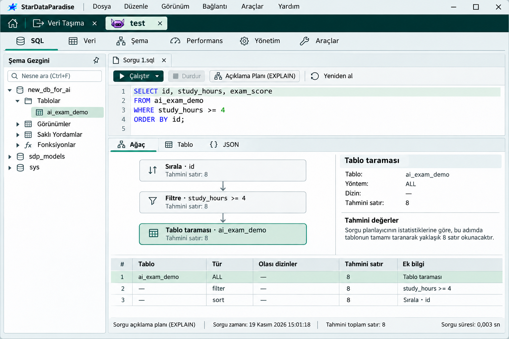

Giriş yolu `SQL → Plan`. Sunucunun sorgu planını ağaç, tablo veya ham çıktı olarak inceleme.

Görünen komutlar EXPLAIN, Yeniden al, Ağaç, Tablo, JSON, düğüm ayrıntısı. Ana eylem **Planı al**.

Plan biçimi sunucu desteğine göre seçilir. Tahmini maliyet ve satır sayısı, ölçülmüş yürütme süresinden ayrı etiketlenir.

[Mevcut kaynak](<C:/Users/Yusuf Salim OZBEK/source/repos/StarDataParadise/out/mysql-workbench-native-src/backend/wbprivate/sqlide/wb_sql_editor_form.cpp>) · [İlgili canlı inceleme](referanslar/mevcut/25-explain.jpg)

## 04 · Sorgu geçmişi

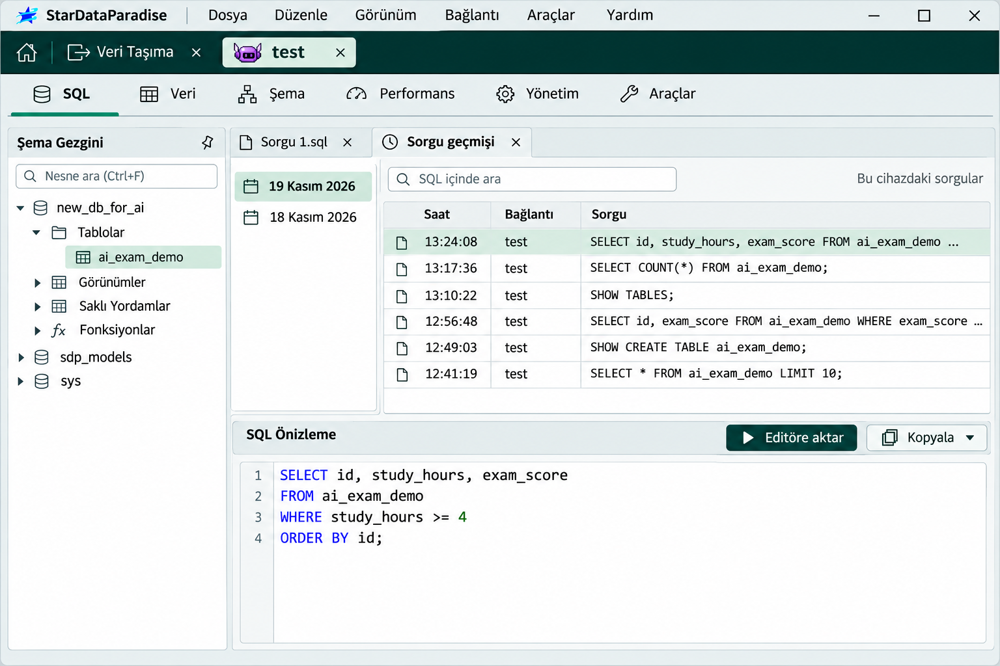

Giriş yolu `SQL → Sorgu geçmişi`. Yerelde kaydedilen SQL ifadelerini bulma ve editöre geri taşıma.

Görünen komutlar Tarih, SQL içinde ara, Editöre aktar, Kopyala. Ana eylem **Editöre aktar**.

Gün seçimi, boş tarih, çok satırlı SQL, geçmiş kaydı kopyalama. SQL tamponuna aktarım ayrı yürütme eylemine hazırlanır.

[Mevcut kaynak](<C:/Users/Yusuf Salim OZBEK/source/repos/StarDataParadise/out/mysql-workbench-native-src/backend/wbprivate/sqlide/db_sql_editor_history_be.cpp>) · [İlgili canlı inceleme](referanslar/mevcut/22-query-history.jpg)

## 05 · SQL parçaları

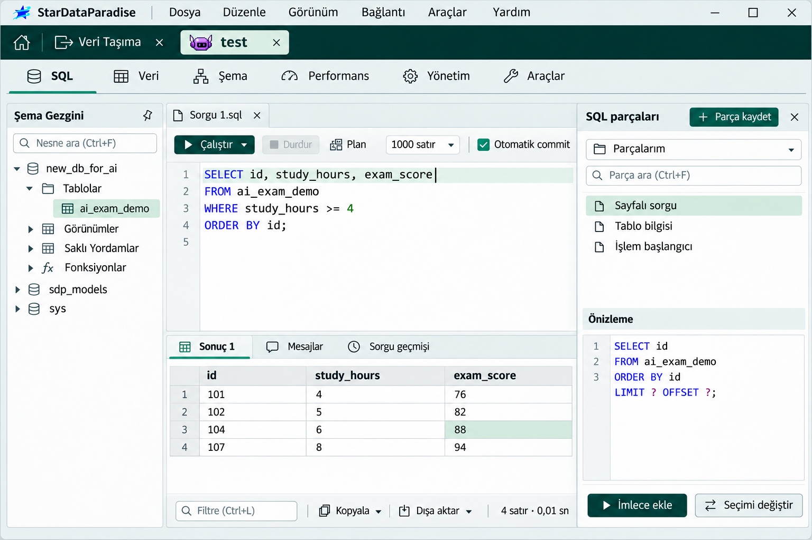

Giriş yolu `SQL → SQL parçaları`. Tekrar kullanılan SQL parçalarını saklama, bulma ve tampona yerleştirme.

Görünen komutlar Kategori, Ara, Parça kaydet, İmlece ekle, Seçimi değiştir. Ana eylem **İmlece ekle**.

Yerleşik ve kullanıcı parçaları, boş kütüphane, seçili metin, kaydetme adı. Silme ve düzenleme bağlam menüsündedir.

[Mevcut kaynak](<C:/Users/Yusuf Salim OZBEK/source/repos/StarDataParadise/out/mysql-workbench-native-src/backend/wbprivate/sqlide/wb_sql_editor_snippets.cpp>) · [İlgili canlı inceleme](referanslar/mevcut/26-snippets.jpg)

## 06 · Bağlamsal SQL yardımı

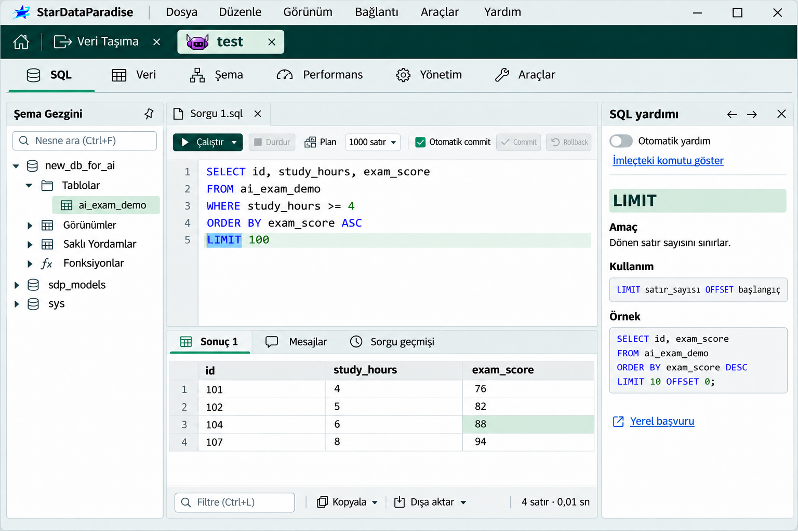

Giriş yolu `SQL → Yardım paneli`. İmleçteki SQL anahtar sözcüğünün yardımını okuma.

Görünen komutlar Geri, İleri, Otomatik yardım, İmleçteki komutu göster, Yerel başvuru. Ana eylem **İmleçteki komutu göster**.

Otomatik yardım kapalı, tanınmayan sözcük, yardım kaynağı eksik. Yardım çekmecesi başlangıçta kapalıdır.

[Mevcut kaynak](<C:/Users/Yusuf Salim OZBEK/source/repos/StarDataParadise/out/mysql-workbench-native-src/backend/wbprivate/sqlide/wb_sql_editor_help.cpp>) · [İlgili canlı inceleme](referanslar/mevcut/01-sql-editor.jpg)

## 07 · Şema ve nesne inceleyicisi

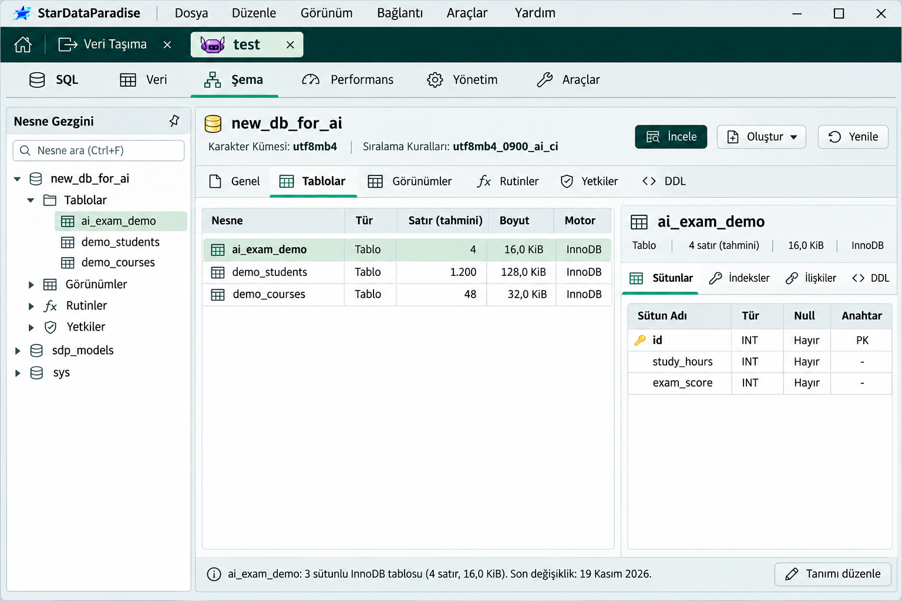

Giriş yolu `Şema → İncele`. Şema ve tablo metadata’sını, indeksleri, ilişkileri, yetkileri ve DDL’yi inceleme.

Görünen komutlar Nesne ara, İncele, Oluştur, Yenile, Genel, Tablolar, Görünümler, Rutinler, Yetkiler, DDL. Ana eylem **Tanımı düzenle**.

Şema ve tablo seçimi aynı inceleyici ailesinde çalışır. Satır ve boyut tahminleri etiketlidir. Bakım ayrı yüzeyde açılır.

[Mevcut kaynak](<C:/Users/Yusuf Salim OZBEK/source/repos/StarDataParadise/out/mysql-workbench-native-src/plugins/wb.sqlide/sqlide_catalogman_ext.py>) · [İlgili canlı inceleme](referanslar/mevcut/16-schema-inspector.jpg)

## 08 · Tablo tasarımı

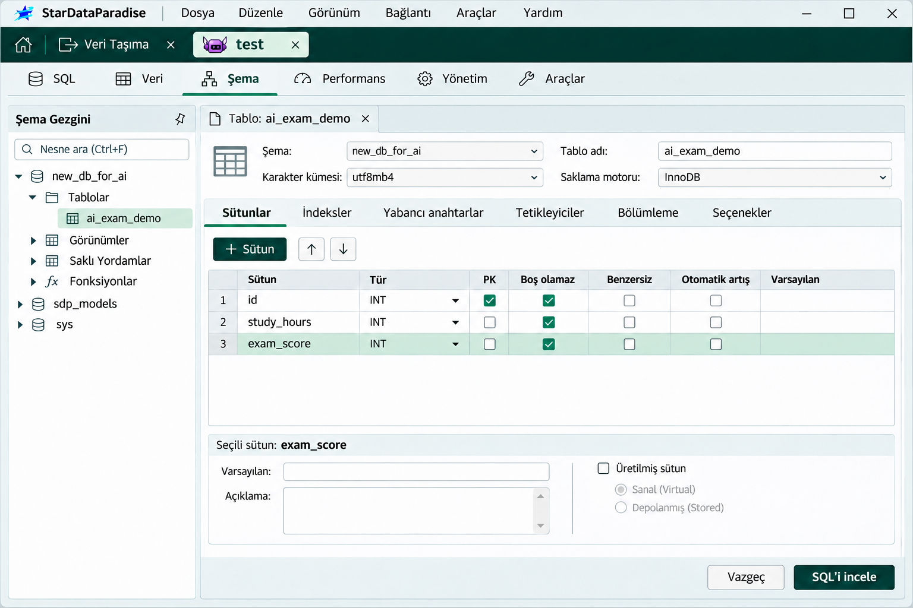

Giriş yolu `Şema → Tablo → Tanımı düzenle`. Tablo sütunlarını ve fiziksel tanımını düzenleme.

Görünen komutlar Sütunlar, İndeksler, Yabancı anahtarlar, Tetikleyiciler, Bölümleme, Seçenekler, Sütun ekle, sıralama. Ana eylem **SQL’i incele**.

Yeni ve mevcut tablo, bağımsız PK/NN/UQ/AI bayrakları, üretilmiş sütun ifadesi ve Virtual/Stored seçimi. Değişiklikler mevcut DDL uygulama akışına gider.

[Mevcut kaynak](<C:/Users/Yusuf Salim OZBEK/source/repos/StarDataParadise/out/mysql-workbench-native-src/plugins/db.mysql.editors/windows/cs/DbMysqlTableEditor.cs>) · [İlgili canlı inceleme](referanslar/mevcut/19-table-editor.jpg)

Sözdizimi, yeni nesne ve düzenleme durumları aynı editör ailesinde çalışır. Değişiklik önizlemesi gerçek native üreticiden gelir. SQL metni görseldeki örnekten kopyalanarak üretilmez.

## 09 · Görünüm düzenleyicisi

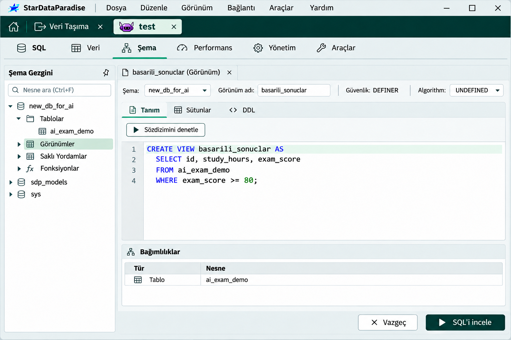

Giriş yolu `Şema → Oluştur → Görünüm`. Görünümün SQL tanımını, algoritmasını ve güvenlik bağlamını düzenleme.

Görünen komutlar Şema, Görünüm adı, Algoritma, Güvenlik, Tanım, Sütunlar, DDL, Sözdizimini denetle. Ana eylem **SQL’i incele**.

CREATE ve ALTER, salt okunur bağımlılık özeti, geçersiz SQL konumu. Kaynak bağımlılıkları katalogdan türetilir.

[Mevcut kaynak](<C:/Users/Yusuf Salim OZBEK/source/repos/StarDataParadise/out/mysql-workbench-native-src/plugins/db.mysql.editors/windows/cs/DbMysqlViewEditor.cs>) · [İlgili canlı inceleme](referanslar/mevcut/01-sql-editor.jpg)

Sözdizimi, yeni nesne ve düzenleme durumları aynı editör ailesinde çalışır. Değişiklik önizlemesi gerçek native üreticiden gelir. SQL metni görseldeki örnekten kopyalanarak üretilmez.

## 10 · Yordam ve fonksiyon düzenleyicisi

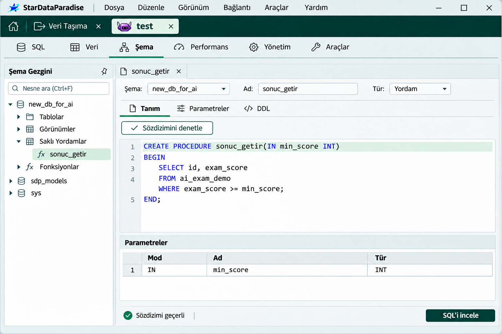

Giriş yolu `Şema → Rutinler → Düzenle`. Yordam ve fonksiyon tanımını ve parametrelerini düzenleme.

Görünen komutlar Tür, Şema, Ad, Tanım, Parametreler, DDL, Sözdizimini denetle. Ana eylem **SQL’i incele**.

Yordamda IN/OUT/INOUT, fonksiyonda dönüş türü. Mevcut Classic rutin editörü ve SQL ayrıştırıcısı kullanılır.

[Mevcut kaynak](<C:/Users/Yusuf Salim OZBEK/source/repos/StarDataParadise/out/mysql-workbench-native-src/plugins/db.mysql.editors/windows/cs/DbMysqlRoutineEditor.cs>) · [İlgili canlı inceleme](referanslar/mevcut/01-sql-editor.jpg)

Sözdizimi, yeni nesne ve düzenleme durumları aynı editör ailesinde çalışır. Değişiklik önizlemesi gerçek native üreticiden gelir. SQL metni görseldeki örnekten kopyalanarak üretilmez.

## 11 · Tablo verisinde arama

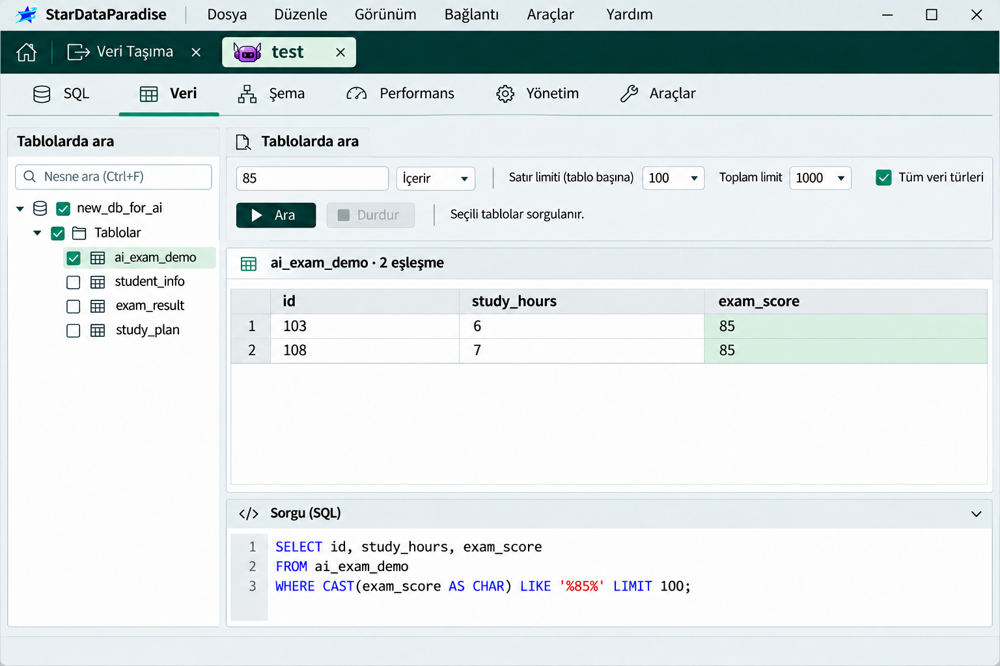

Giriş yolu `Veri → Tablolarda ara`. Seçilen tablolarda kapsamı ve limiti belirlenmiş metin araması yapma.

Görünen komutlar Kapsam, eşleme yöntemi, tablo başına sınır, toplam sınır, tüm türler, Ara, Durdur. Ana eylem **Ara**.

Arama sonucu, sıfır eşleşme, sorgu hatası, iptal. Önizleme mevcut arama üreticisinin gerçek SQL’ini gösterir.

[Mevcut kaynak](<C:/Users/Yusuf Salim OZBEK/source/repos/StarDataParadise/out/mysql-workbench-native-src/plugins/wb.sqlide/sqlide_grt.py>) · [İlgili canlı inceleme](referanslar/mevcut/20-data-search.jpg)

## 12 · Sunucu özeti

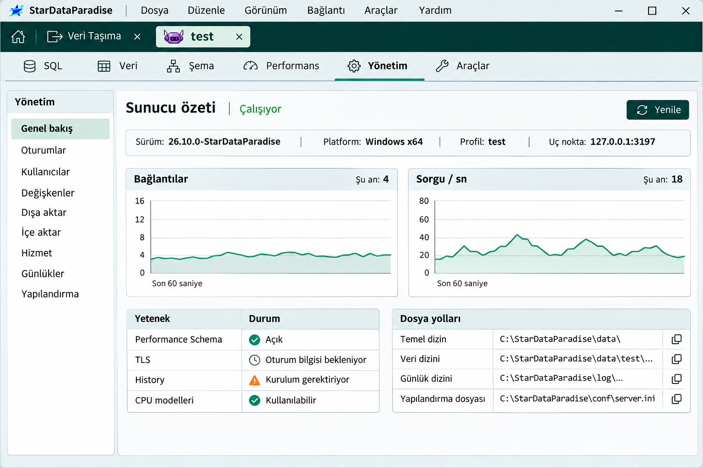

Giriş yolu `Yönetim → Genel bakış`. Bağlı sunucunun sürümünü, etkinlik özetini, dosya yollarını ve kullanılabilir araçlarını okuma.

Görünen komutlar Yenile, dosya yolu kopyalama, özellik durumu. Ana eylem **Yenile**.

Profilin uç noktası ve sunucunun bildirdiği port ayrı kaynaklardır. TLS durumu oturum bilgisinden alınır. Bilinmeyen değer açıkça belirtilir.

[Mevcut kaynak](<C:/Users/Yusuf Salim OZBEK/source/repos/StarDataParadise/out/mysql-workbench-native-src/plugins/wb.admin/frontend/wb_admin_server_status.py>) · [İlgili canlı inceleme](referanslar/mevcut/03-server-status.jpg)

## 13 · İstemci oturumları

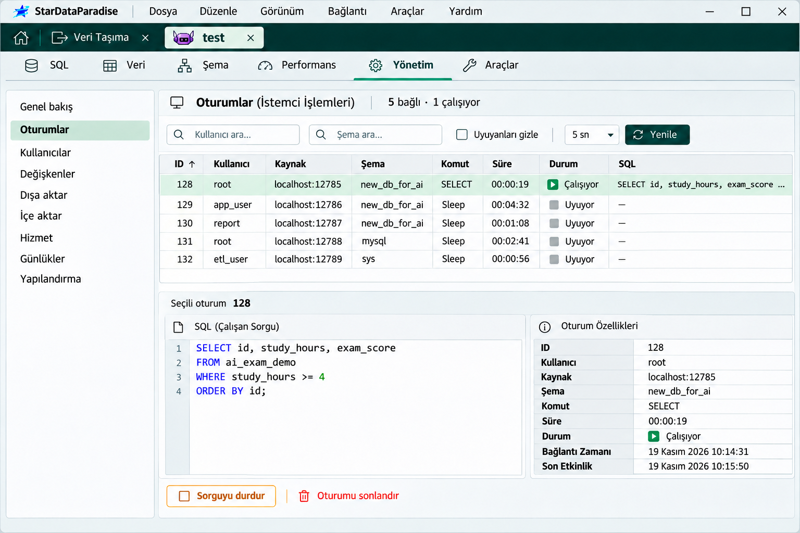

Giriş yolu `Yönetim → Oturumlar`. Sunucu oturumlarını ve çalışan sorguları inceleme.

Görünen komutlar Kullanıcı/şema filtresi, Uyuyanları gizle, yenileme aralığı, Yenile, Sorguyu durdur, Oturumu sonlandır. Ana eylem **Seçilen oturumu incele**.

Sorgu iptali ve bağlantı sonlandırma ayrı komutlardır. Kendi bağlantısı, yetki reddi, artık mevcut olmayan işlem ve yenileme sırasında seçim korunması ele alınır.

[Mevcut kaynak](<C:/Users/Yusuf Salim OZBEK/source/repos/StarDataParadise/out/mysql-workbench-native-src/plugins/wb.admin/frontend/wb_admin_connections.py>) · [İlgili canlı inceleme](referanslar/mevcut/04-client-connections.jpg)

## 14 · Kullanıcılar ve yetkiler

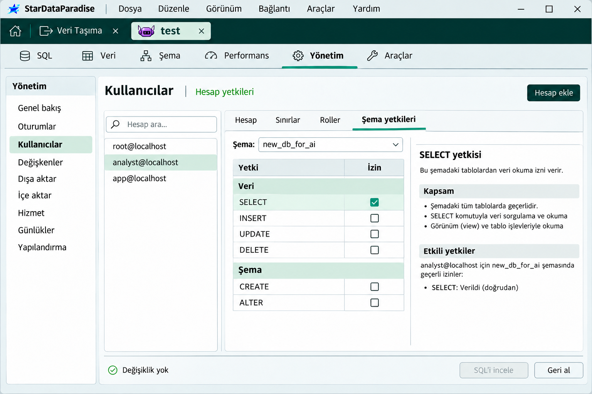

Giriş yolu `Yönetim → Kullanıcılar`. Hesapların giriş özelliklerini, sınırlarını, rollerini ve şema yetkilerini düzenleme.

Görünen komutlar Hesap ekle, Hesap, Sınırlar, Roller, Şema yetkileri, Geri al. Ana eylem **SQL’i incele**.

Mevcut hesap ve yeni hesap aynı form ailesidir. GRANT kapsamı hesap ve host ile birlikte görünür. Etkili yetki özeti ek sorgu uyarlaması gerektirir.

[Mevcut kaynak](<C:/Users/Yusuf Salim OZBEK/source/repos/StarDataParadise/out/mysql-workbench-native-src/plugins/wb.admin/frontend/wb_admin_security.py>) · [İlgili canlı inceleme](referanslar/mevcut/05-users-privileges.jpg)

## 15 · Durum ve sistem değişkenleri

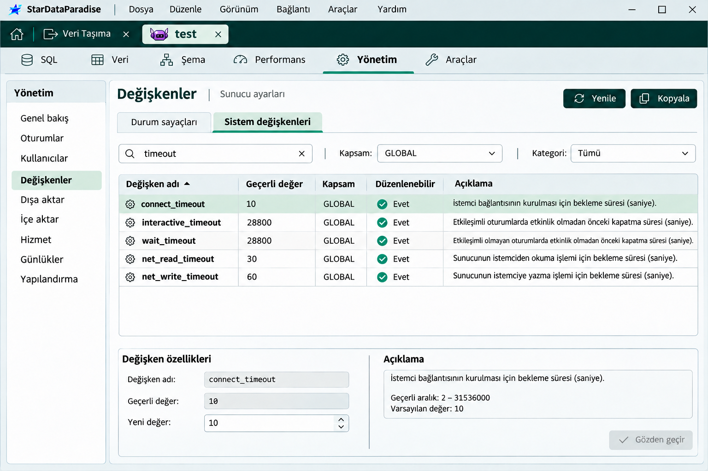

Giriş yolu `Yönetim → Değişkenler`. Durum sayaçlarını ve oturum/global sistem değişkenlerini bulma ve inceleme.

Görünen komutlar Durum sayaçları, Sistem değişkenleri, kategori, kapsam, filtre, Yenile, Kopyala, yeni değer. Ana eylem **Gözden geçir**.

Salt okunur, dinamik ve statik değişken ayrımı metadata’dan gelir. Oturum kapsamı, global kapsam ve yapılandırma dosyasının kalıcılığı ayrıdır.

[Mevcut kaynak](<C:/Users/Yusuf Salim OZBEK/source/repos/StarDataParadise/out/mysql-workbench-native-src/plugins/wb.admin/frontend/wb_admin_variables.py>) · [İlgili canlı inceleme](referanslar/mevcut/06-status-variables.jpg)

## 16 · Performans izleme

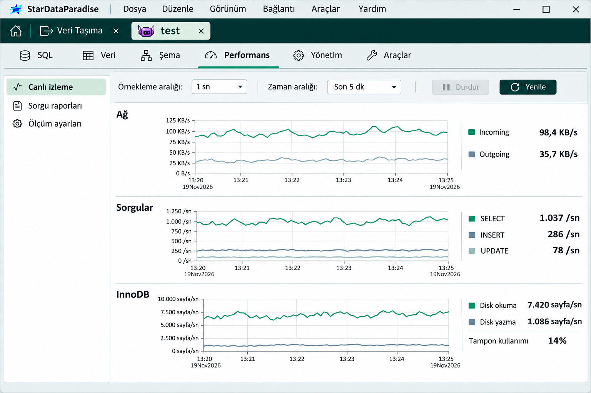

Giriş yolu `Performans → Canlı izleme`. Ağ, sorgu ve depolama etkinliğini zaman içinde izleme.

Görünen komutlar Örnekleme aralığı, zaman penceresi, Duraklat, Yenile. Ana eylem **İzlemeyi sürdür**.

Eksik ölçüm, bağlantı kaybı, boş örnek aralığı, duraklatma. Grafik eksenleri ve birimler her seride görünür.

[Mevcut kaynak](<C:/Users/Yusuf Salim OZBEK/source/repos/StarDataParadise/out/mysql-workbench-native-src/plugins/wb.admin/frontend/wb_admin_performance_dashboard.py>) · [İlgili canlı inceleme](referanslar/mevcut/12-performance-dashboard.jpg)

## 17 · Performans raporları

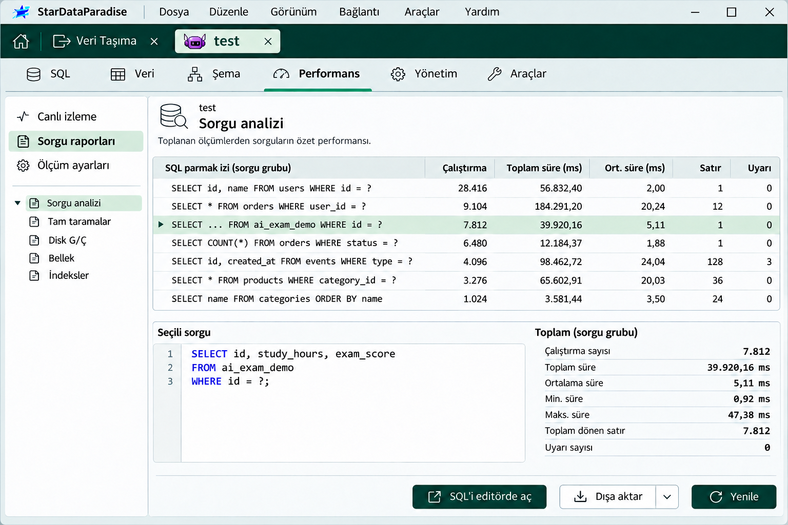

Giriş yolu `Performans → Sorgu raporları`. Performance Schema/sys raporlarından sorgu gruplarını ve kaynak tüketimini inceleme.

Görünen komutlar Rapor kategorisi, Yenile, Dışa aktar, SQL’i editörde aç. Ana eylem **SQL’i editörde aç**.

Rapor desteği, yetki eksikliği, boş sonuç. İstatistiklerin toplama kapsamı ve süre birimleri gösterilir.

[Mevcut kaynak](<C:/Users/Yusuf Salim OZBEK/source/repos/StarDataParadise/out/mysql-workbench-native-src/plugins/wb.admin/frontend/wb_admin_perfschema_reports.py>) · [İlgili canlı inceleme](referanslar/mevcut/13-performance-reports.jpg)

## 18 · Performans ölçüm ayarları

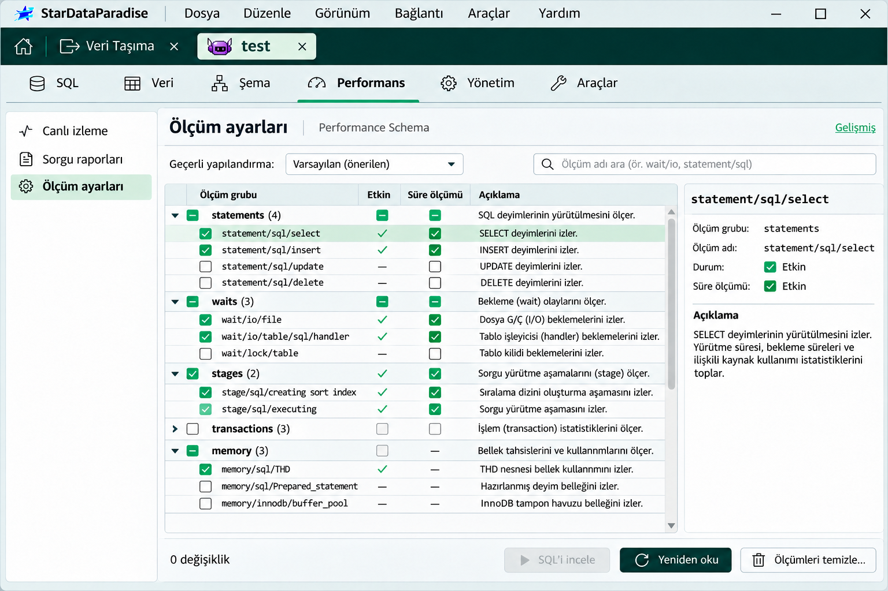

Giriş yolu `Performans → Ölçüm ayarları`. Performance Schema instruments/consumers ayarlarını inceleme ve hazırlama.

Görünen komutlar Ölçüm grubu, Etkin, Süre ölçümü, Gelişmiş, Yeniden oku, SQL’i incele, Ölçümleri temizle. Ana eylem **Değişiklikleri incele**.

TIMED alanı boolean olarak gösterilir. Grup satırlarında üç durumlu seçim bulunur. Veri temizleme ile yapılandırma uygulaması ayrı eylemlerdir.

[Mevcut kaynak](<C:/Users/Yusuf Salim OZBEK/source/repos/StarDataParadise/out/mysql-workbench-native-src/plugins/wb.admin/frontend/wb_admin_perfschema_instrumentation.py>) · [İlgili canlı inceleme](referanslar/mevcut/14-performance-setup-empty.jpg)

## 19 · SQL dışa aktarma

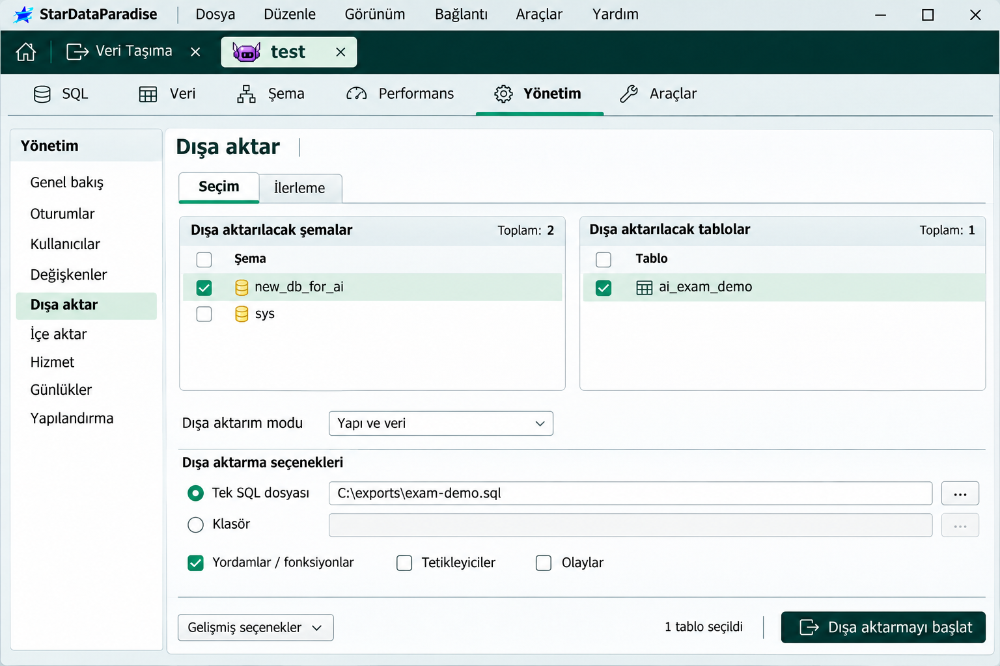

Giriş yolu `Yönetim → Dışa aktar`. Seçilen nesnelerden SQL dökümü üretme.

Görünen komutlar Nesneler, yapı/veri modu, yordamlar, tetikleyiciler, olaylar, dosya/klasör, Gelişmiş seçenekler, İlerleme. Ana eylem **Dışa aktarmayı başlat**.

Yazılabilir hedef, araç bulunamaması, araç sürümü, mevcut dosya, çalışan iş ve hata çıktısı. Mevcut dump motorunun seçenekleri korunur.

[Mevcut kaynak](<C:/Users/Yusuf Salim OZBEK/source/repos/StarDataParadise/out/mysql-workbench-native-src/plugins/wb.admin/frontend/wb_admin_export.py>) · [İlgili canlı inceleme](referanslar/mevcut/07-data-export.jpg)

## 20 · SQL içe aktarma

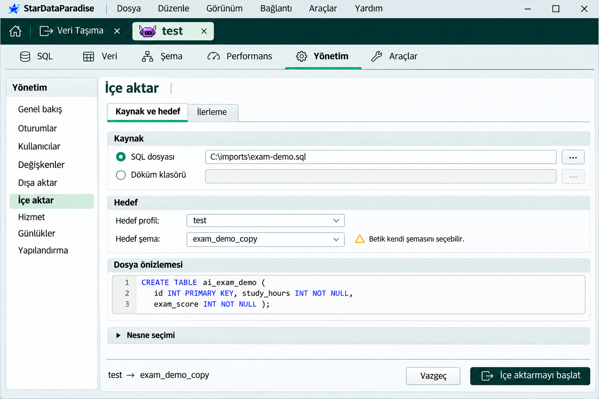

Giriş yolu `Yönetim → İçe aktar`. SQL dosyası veya döküm klasörünü seçilen bağlantıya yükleme.

Görünen komutlar Kaynak, hedef profil, hedef şema, klasör nesneleri, dosya önizlemesi, İlerleme. Ana eylem **İçe aktarmayı başlat**.

Betikteki USE ve CREATE DATABASE etkisi görünür. Dosya önizleme ve hedef özeti için yeni UI bağları gerekir.

[Mevcut kaynak](<C:/Users/Yusuf Salim OZBEK/source/repos/StarDataParadise/out/mysql-workbench-native-src/plugins/wb.admin/frontend/wb_admin_export.py>) · [İlgili canlı inceleme](referanslar/mevcut/08-data-import.jpg)

## 21 · Sunucu hizmeti

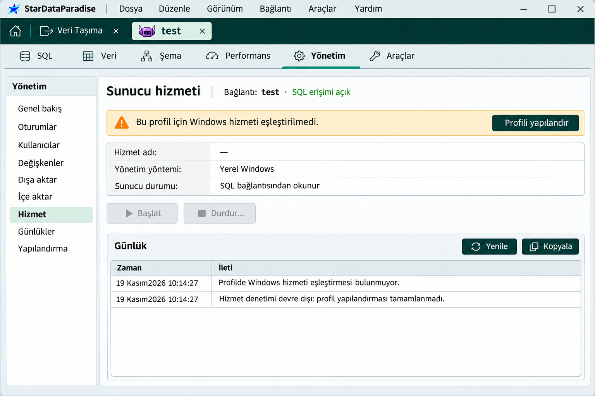

Giriş yolu `Yönetim → Hizmet`. Profille eşleştirilmiş hizmeti izleme ve denetleme.

Görünen komutlar Profili yapılandır, Başlat, Durdur, Yenile, Kopyala. Ana eylem **Profili yapılandır**.

Hizmet adı eksik, yerel/SSH yönetimi, yönetim erişimi reddi, bağlı istemciler. Hizmet kimliği profil kaydından doğrulanır.

[Mevcut kaynak](<C:/Users/Yusuf Salim OZBEK/source/repos/StarDataParadise/out/mysql-workbench-native-src/plugins/wb.admin/frontend/wb_admin_configuration_startup.py>) · [İlgili canlı inceleme](referanslar/mevcut/09-service-control.jpg)

## 22 · Sunucu günlükleri

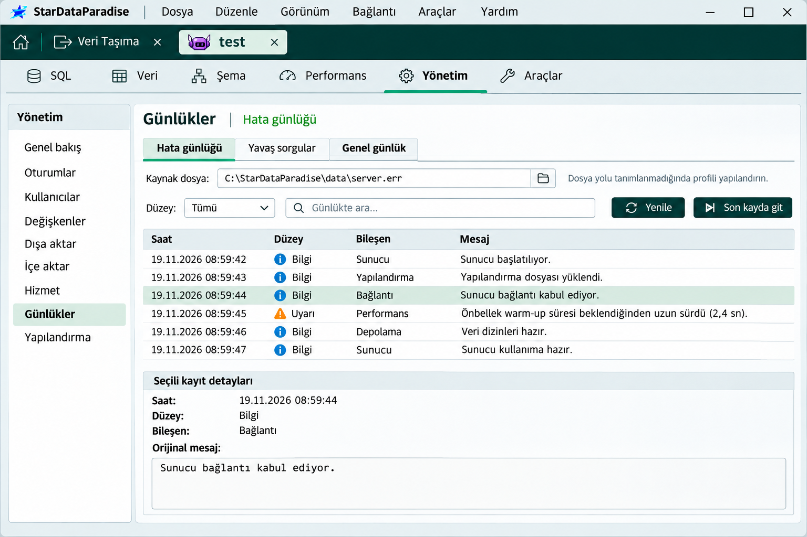

Giriş yolu `Yönetim → Günlükler`. Hata, yavaş sorgu ve genel günlüğü sayfalayarak okuma.

Görünen komutlar Kaynak yol, tür, düzey, arama, Yenile, Son kayda git, önceki/sonraki sayfa. Ana eylem **Yenile**.

Kaynak yolu eksik, dosya okunamıyor, döndürülmüş günlük, boş sonuç. Özgün kayıt metni ayrıntıda korunur.

[Mevcut kaynak](<C:/Users/Yusuf Salim OZBEK/source/repos/StarDataParadise/out/mysql-workbench-native-src/plugins/wb.admin/frontend/wb_admin_logs.py>) · [İlgili canlı inceleme](referanslar/mevcut/10-logs-config-required.jpg)

## 23 · Seçenek dosyası

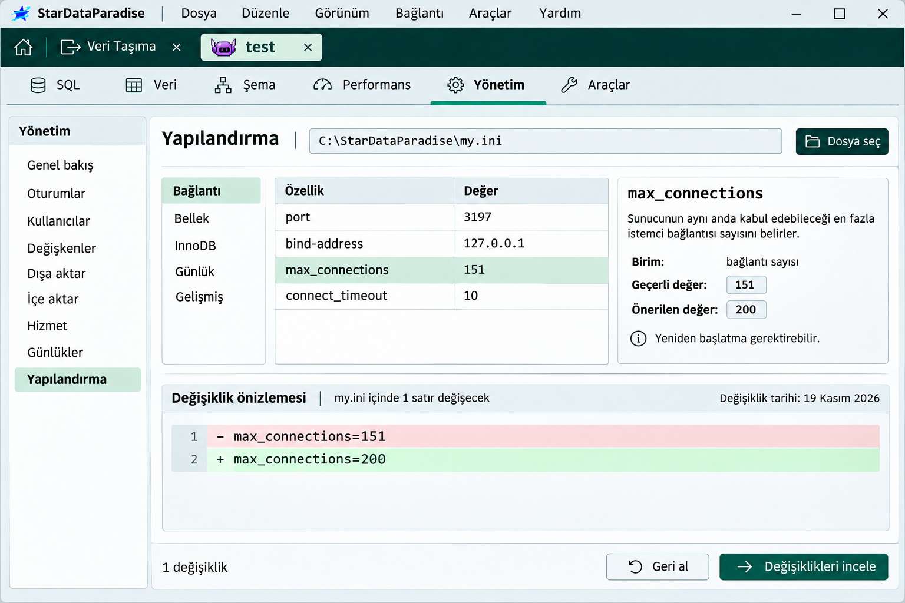

Giriş yolu `Yönetim → Yapılandırma`. Sunucu seçenek dosyasını kategorilere göre düzenleme.

Görünen komutlar Dosya seç, kategori, ara, mevcut/önerilen değer, fark, Geri al. Ana eylem **Değişiklikleri incele**.

Dosya eksik veya salt okunur, dışarıdan değişmiş dosya, sürüme bağlı seçenekler, yeniden başlatma ihtiyacı. Dosya ve canlı değişkenler ayrı saklama hedefleridir.

[Mevcut kaynak](<C:/Users/Yusuf Salim OZBEK/source/repos/StarDataParadise/out/mysql-workbench-native-src/plugins/wb.admin/frontend/wb_admin_config_file_ui.py>) · [İlgili canlı inceleme](referanslar/mevcut/11-options-config-required.jpg)

## 24 · Uygulama tercihleri

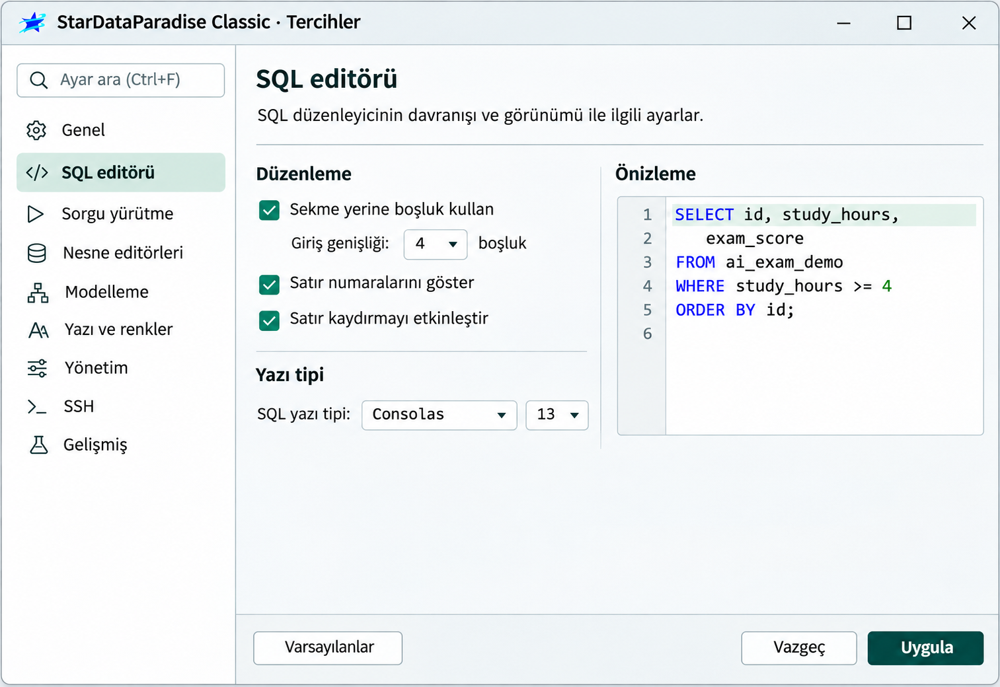

Giriş yolu `Araçlar → Tercihler`. Editör, sorgu yürütme, modelleme, görünüm ve araç tercihlerini düzenleme.

Görünen komutlar Ayar ara, kategoriler, yazı önizlemesi, Varsayılanlar, Vazgeç, Uygula. Ana eylem **Uygula**.

Kategori içeriği mevcut preference anahtarlarından gelir. Arama ve ortak tipografi önizlemesi yeni UI bileşenidir. Bağlantı TLS/SSH alanları profil yöneticisinde bulunur.

[Mevcut kaynak](<C:/Users/Yusuf Salim OZBEK/source/repos/StarDataParadise/out/mysql-workbench-native-src/frontend/common/preferences_form.cpp>) · [İlgili canlı inceleme](referanslar/mevcut/21-preferences.jpg)

Tercih alt sayfaları bu form şablonunu paylaşır. Genel düzenleyici, SQL editörü, sorgu editörü, nesne editörleri, yürütme, yönetim, modelleme varsayılanları, modelleme veritabanı ayarları, diyagram, görünüm, yazı/renk, SSH ve diğer ayar grupları mevcut preference anahtarlarıyla eşleştirilir.

## 25 · Betikler ve eklentiler

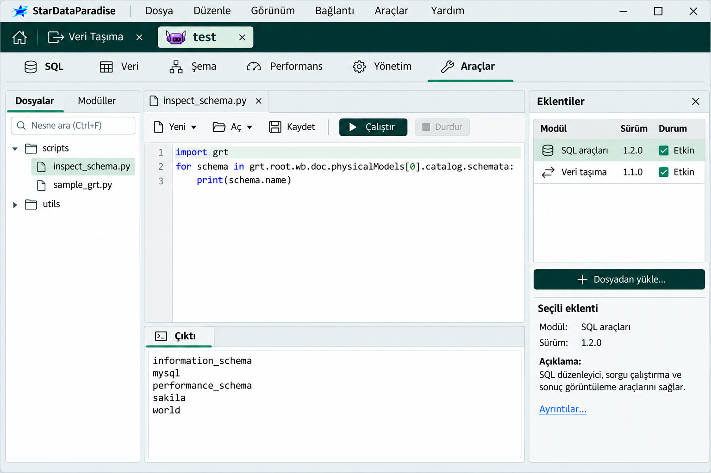

Giriş yolu `Araçlar → Betikler`. Python/GRT betiklerini ve kurulu modülleri yönetme.

Görünen komutlar Yeni, Aç, Kaydet, Çalıştır, Durdur, Dosyalar, Modüller, Çıktı, Eklentiler, Dosyadan yükle. Ana eylem **Çalıştır**.

Dosya hatası, Python istisnası, çalışan betik, eklenti ayrıntısı. Yerleşik ayrı betik penceresi bu çalışma alanına uyarlanır.

[Mevcut kaynak](<C:/Users/Yusuf Salim OZBEK/source/repos/StarDataParadise/out/mysql-workbench-native-src/frontend/windows/MySQLWorkbench/MainForm.cs>) · [İlgili canlı inceleme](referanslar/mevcut/23-scripting.jpg)

## 26 · Sunucudan model çıkarma

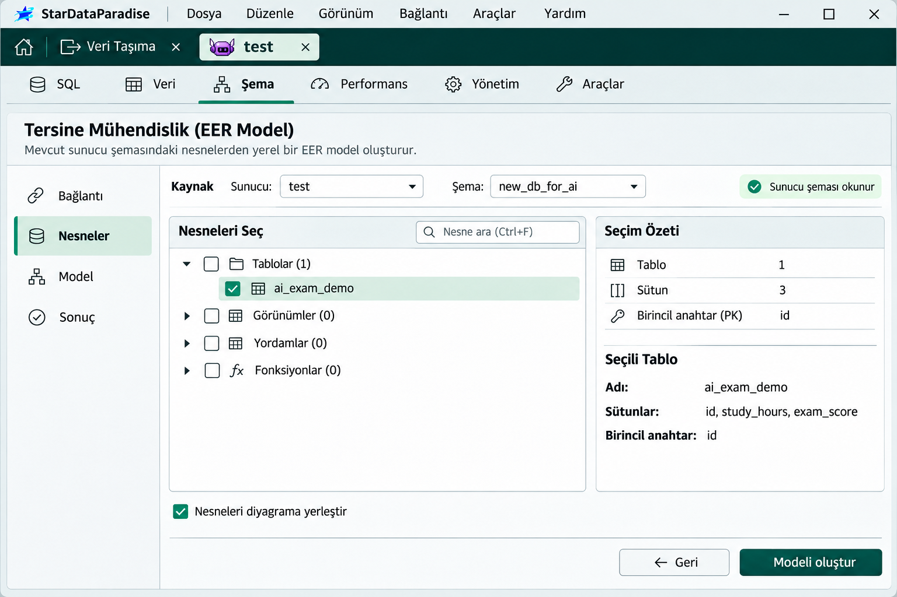

Giriş yolu `Şema → Sunucudan model çıkar`. Sunucu şemasının metadata’sından yerel EER modeli oluşturma.

Görünen komutlar Bağlantı, Nesneler, Model, Sonuç, nesne seçimi, diyagrama yerleştir. Ana eylem **Modeli oluştur**.

Nesne okuma yetkisi, desteklenmeyen tip, boş seçim, mevcut yerel modele aktarım. Sonuç yerel model alanında açılır.

[Mevcut kaynak](<C:/Users/Yusuf Salim OZBEK/source/repos/StarDataParadise/out/mysql-workbench-native-src/modules/db.mysql/db_mysql_re_grt.py>) · [İlgili canlı inceleme](referanslar/mevcut/16-schema-inspector.jpg)

## 27 · Şema aktarımı

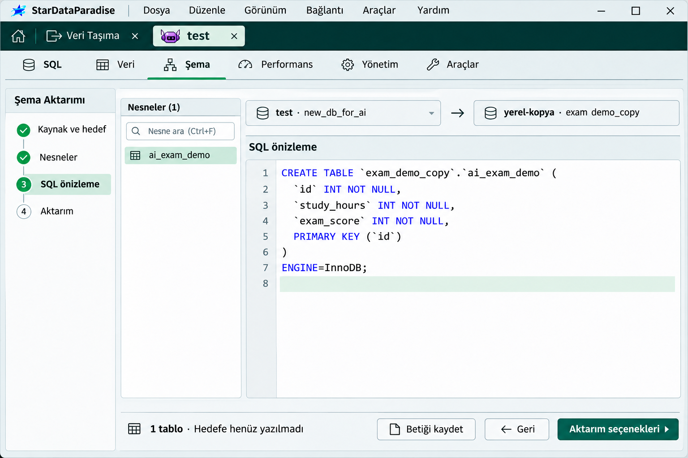

Giriş yolu `Şema → Şema aktarımı`. Uyumlu iki sunucu arasında şema kopyalama akışını hazırlama.

Görünen komutlar Kaynak/hedef, nesneler, SQL önizleme, Betiği kaydet, aktarım seçenekleri. Ana eylem **Aktarım seçenekleri**.

Önizleme mevcut göç SQL görüntüleyicisiyle paylaşılır. Kaynak ve hedef kimlikleri bütün adımlarda korunur.

[Mevcut kaynak](<C:/Users/Yusuf Salim OZBEK/source/repos/StarDataParadise/out/mysql-workbench-native-src/plugins/migration/dbcopy/db_copy_main.py>) · [İlgili canlı inceleme](referanslar/mevcut/16-schema-inspector.jpg)

## 28 · CSV ve JSON aktarımı

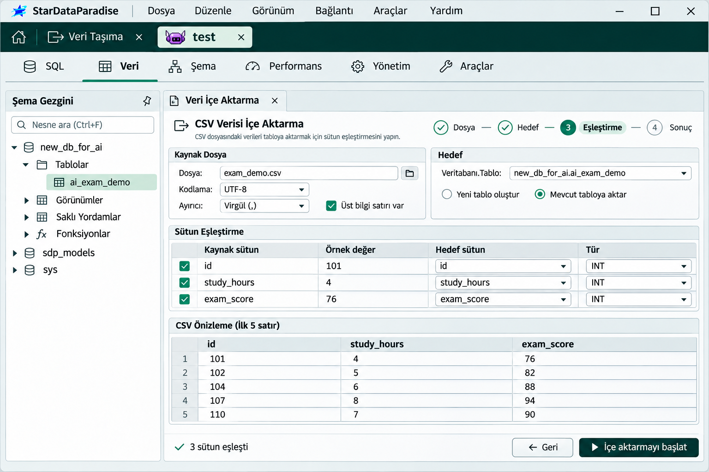

Giriş yolu `Veri → Dosyadan içe aktar / Dışa aktar`. CSV/JSON sütunlarını hedef tabloya eşleştirerek içe aktarma.

Görünen komutlar Dosya, hedef, yeni/mevcut tablo, kodlama, ayraç, başlık satırı, eşleştirme, tür, önizleme. Ana eylem **İçe aktarmayı başlat**.

Eksik ve fazla sütun, boş değer, dönüşüm hatası, hassas sayılar ve UTF-8. Silme/üzerine yazma seçenekleri ayrıca incelenir.

[Mevcut kaynak](<C:/Users/Yusuf Salim OZBEK/source/repos/StarDataParadise/out/mysql-workbench-native-src/plugins/wb.sqlide/sqlide_power_import_wizard.py>) · [İlgili canlı inceleme](referanslar/mevcut/20-data-search.jpg)

## 29 · SQL değişiklik incelemesi

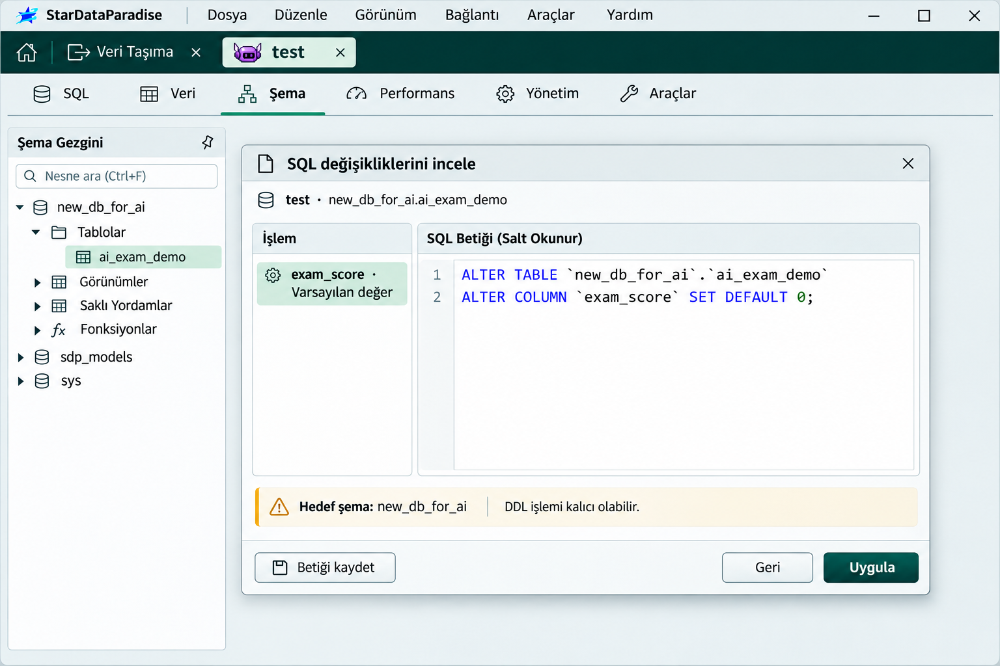

Giriş yolu `Şema / Veri → SQL’i incele`. Hazırlanan DDL veya veri değişikliği SQL’ini uygulamadan önce inceleme.

Görünen komutlar İşlem listesi, salt okunur SQL, hedef özeti, Betiği kaydet, Geri, Uygula. Ana eylem **Uygula**.

İfade bazlı hata, kısmen uygulanmış DDL, hedef bağlantı değişimi. Başarı ve hata native uygulama sonucundan gelir.

[Mevcut kaynak](<C:/Users/Yusuf Salim OZBEK/source/repos/StarDataParadise/out/mysql-workbench-native-src/backend/wbprivate/sqlide/wb_sql_editor_form_ui.cpp>) · [İlgili canlı inceleme](referanslar/mevcut/19-table-editor.jpg)

## 30 · SQL betik çalıştırma

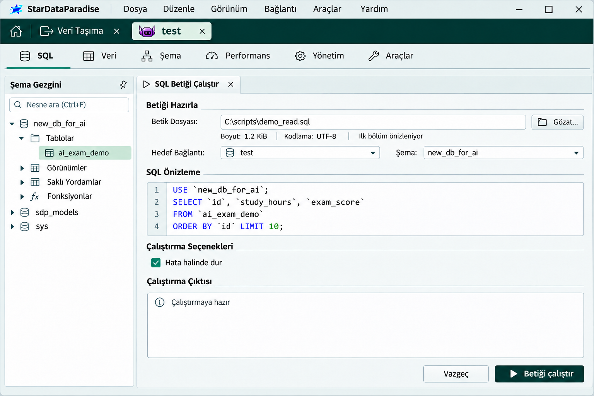

Giriş yolu `Dosya → SQL betiği çalıştır`. Dış SQL dosyasını belirtilen bağlantı ve şemada yürütmeye hazırlama.

Görünen komutlar Dosya, kodlama, önizleme, hedef, Hata halinde dur, çıktı. Ana eylem **Betiği çalıştır**.

Dosyanın ilk bölümü önizlenir. Dosya kodlaması, hata halinde dur seçimi ve native runner davranışı korunur.

[Mevcut kaynak](<C:/Users/Yusuf Salim OZBEK/source/repos/StarDataParadise/out/mysql-workbench-native-src/plugins/wb.sqlide/run_script.py>) · [İlgili canlı inceleme](referanslar/mevcut/01-sql-editor.jpg)

## 31 · Yardım ve ürün bilgisi

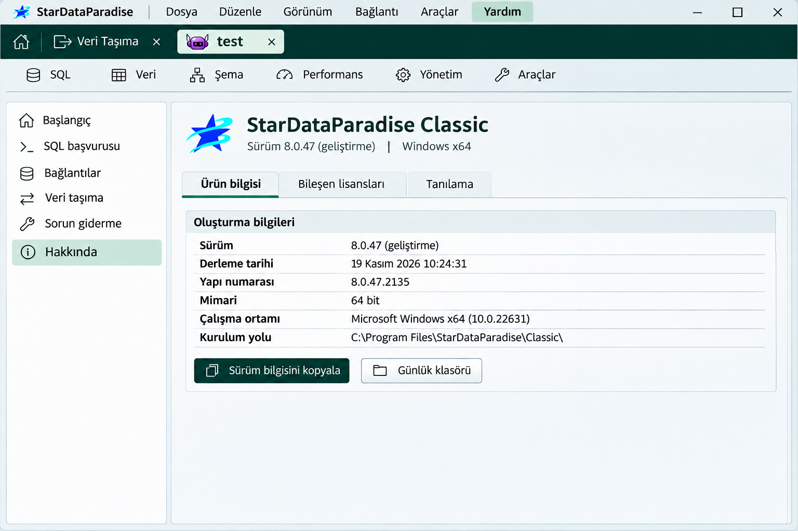

Giriş yolu `Yardım → Ürün bilgisi`. Ürün bilgisine, bileşen lisanslarına ve yerel tanılamaya erişme.

Görünen komutlar Ürün bilgisi, Bileşen lisansları, Tanılama, Sürüm bilgisini kopyala, Günlük klasörü. Ana eylem **Sürüm bilgisini kopyala**.

Help dış bağlantı hedefleri kullanıcının son isteğiyle sonraki aşamaya bırakıldı. Sürüm ve kurulum bilgisi çalışma zamanından okunur.

[Mevcut kaynak](<C:/Users/Yusuf Salim OZBEK/source/repos/StarDataParadise/out/mysql-workbench-native-src/backend/wbprivate/workbench/wb_context_ui.cpp>) · [İlgili canlı inceleme](referanslar/mevcut/01-sql-editor.jpg)

## 32 · Veri değişiklik geçmişi

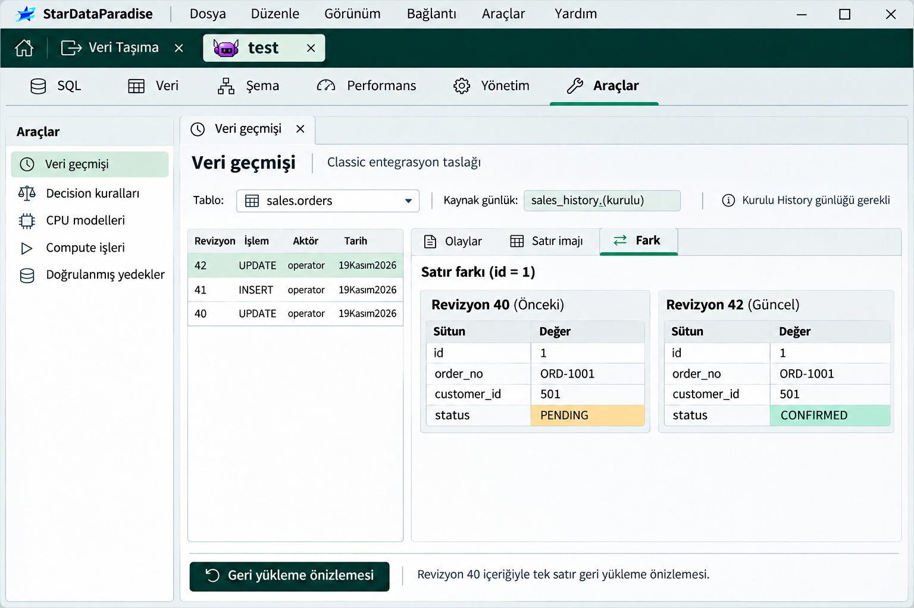

Giriş yolu `Araçlar → Veri geçmişi`. Kurulu tablo günlüğünden revizyon ve satır farklarını okuma.

Görünen komutlar Tablo/günlük, revizyon, Olaylar, Satır imajı, Fark, geri yükleme önizlemesi. Ana eylem **Geri yükleme önizlemesi**.

Classic adaptörü gerekir. Mevcut history_log/read/diff kullanılır. Tek BIGINT anahtarlı mevcut satırın BIGINT/metin alanları restore preview/apply ile hazırlanır. BLOB geri yükleme, şema geçmişi ve silinen satır kurtarma ek kapsamdır.

[Mevcut kaynak](<C:/Users/Yusuf Salim OZBEK/source/repos/StarDataParadiseServer/compatibility/history/README.md>) · [İlgili canlı inceleme](referanslar/mevcut/16-schema-inspector.jpg)

**Classic arayüz entegrasyonu önerisi.** Bu sayfanın görsel denemesi mevcut yönetim API’lerinin veya SQL/CLI araçlarının yeni bir arayüze bağlanmasını öngörür. Bu çalışmada entegrasyon kodu ve canlı işlem kabulü üretilmedi.

## 33 · Decision kuralları

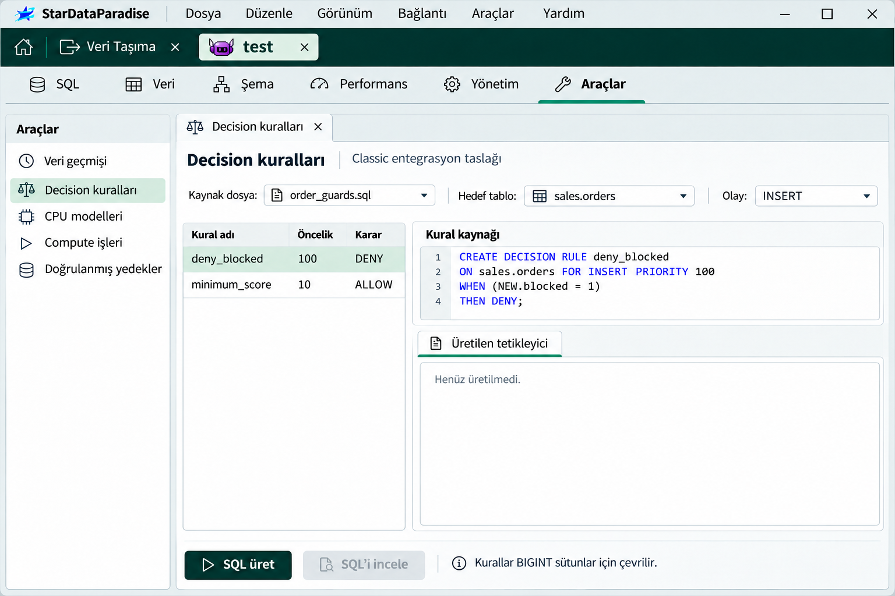

Giriş yolu `Araçlar → Decision kuralları`. Belgelenmiş Decision kural alt kümesini tetikleyici SQL’ine çevirme.

Görünen komutlar Kaynak dosya, tablo, olay, kural/öncelik, kaynak SQL, üretilen SQL. Ana eylem **SQL üret**.

Classic adaptörü gerekir. BIGINT koşulları ve mevcut provision.py çeviricisi kullanılır. Kural setinin tamamı aynı üretim çağrısına gider.

[Mevcut kaynak](<C:/Users/Yusuf Salim OZBEK/source/repos/StarDataParadiseServer/compatibility/decision/README.md>) · [İlgili canlı inceleme](referanslar/mevcut/19-table-editor.jpg)

**Classic arayüz entegrasyonu önerisi.** Bu sayfanın görsel denemesi mevcut yönetim API’lerinin veya SQL/CLI araçlarının yeni bir arayüze bağlanmasını öngörür. Bu çalışmada entegrasyon kodu ve canlı işlem kabulü üretilmedi.

Üretilen tetikleyici için gerçek provision.py çıktısı kullanılır. Kural listesindeki tüm kurallar aynı sete dahildir. Üretimden önce önizleme alanı boş durum gösterir.

## 34 · CPU model kayıtları

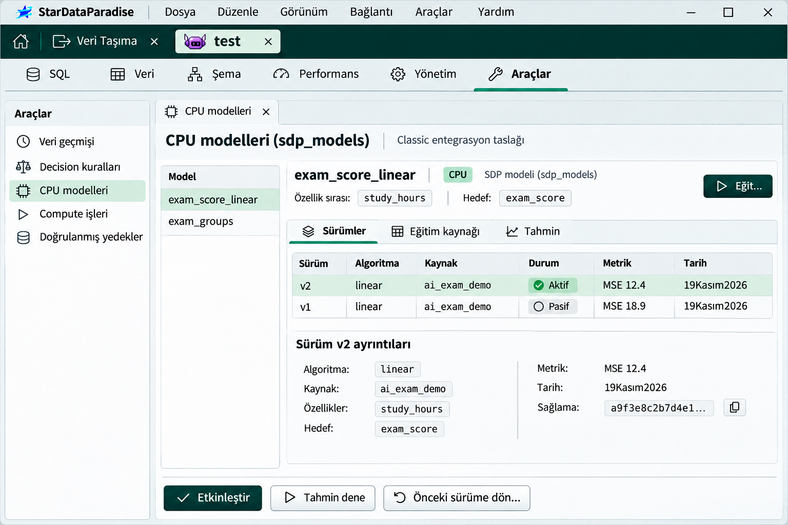

Giriş yolu `Araçlar → CPU modelleri`. CPU model sürümlerini, eğitim kaynağını, etkin sürümü ve tahmini yönetme.

Görünen komutlar Model, Sürümler, Eğitim kaynağı, Tahmin, Eğit, Etkinleştir, Önceki sürüme dön. Ana eylem **Seçili sürümü incele**.

Classic adaptörü gerekir. Mevcut sekiz CPU algoritması, özellik sırası ve sürüm checksum’ı kullanılır. GPU/dataset/checkpoint arayüzleri ayrı kapsamdır.

[Mevcut kaynak](<C:/Users/Yusuf Salim OZBEK/source/repos/StarDataParadiseServer/compatibility/README.md>) · [İlgili canlı inceleme](referanslar/mevcut/16-schema-inspector.jpg)

**Classic arayüz entegrasyonu önerisi.** Bu sayfanın görsel denemesi mevcut yönetim API’lerinin veya SQL/CLI araçlarının yeni bir arayüze bağlanmasını öngörür. Bu çalışmada entegrasyon kodu ve canlı işlem kabulü üretilmedi.

## 35 · Compute işleri ve zamanlamalar

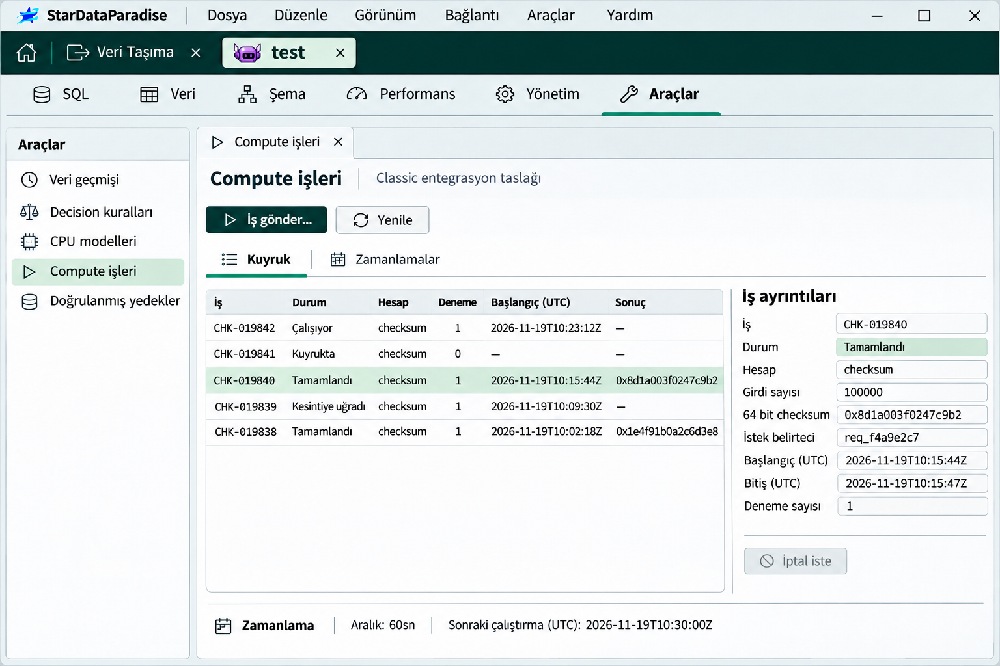

Giriş yolu `Araçlar → Compute işleri`. Checksum compute kuyruğunu ve UTC aralıklı zamanlamaları yönetme.

Görünen komutlar Kuyruk, Zamanlamalar, İş gönder, Yenile, İptal iste, sonuç ayrıntısı. Ana eylem **İş gönder**.

Classic adaptörü gerekir. Gerçek kuyruğun durumları ve iptal isteği gösterilir. Sonuç hassasiyeti string/64-bit olarak korunur.

[Mevcut kaynak](<C:/Users/Yusuf Salim OZBEK/source/repos/StarDataParadiseServer/compatibility/jobs/compute_jobs.py>) · [İlgili canlı inceleme](referanslar/mevcut/04-client-connections.jpg)

**Classic arayüz entegrasyonu önerisi.** Bu sayfanın görsel denemesi mevcut yönetim API’lerinin veya SQL/CLI araçlarının yeni bir arayüze bağlanmasını öngörür. Bu çalışmada entegrasyon kodu ve canlı işlem kabulü üretilmedi.

## 36 · Doğrulanmış yedekler

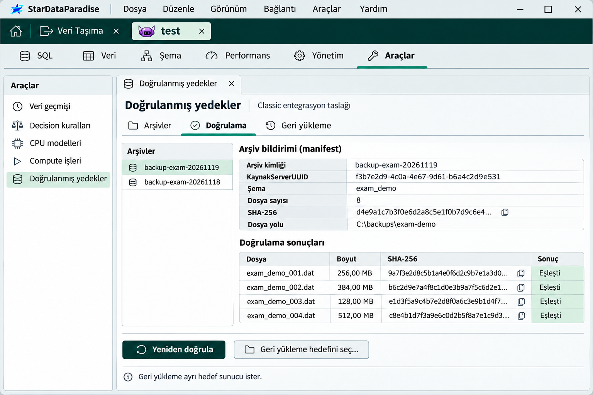

Giriş yolu `Araçlar → Doğrulanmış yedekler`. Mantıksal/fiziksel arşivleri, manifestlerini ve doğrulama sonuçlarını inceleme.

Görünen komutlar Arşivler, Doğrulama, Geri yükleme, Yeniden doğrula, hedef seç. Ana eylem **Yeniden doğrula**.

Classic adaptörü gerekir. Fiziksel ve mantıksal yedek formatı/araç seçimi görünür. Geri yükleme hedef UUID ve şema koşulları mevcut sağlayıcının sözleşmesinden gelir.

[Mevcut kaynak](<C:/Users/Yusuf Salim OZBEK/source/repos/StarDataParadiseServer/compatibility/backup/PHYSICAL.md>) · [İlgili canlı inceleme](referanslar/mevcut/07-data-export.jpg)

**Classic arayüz entegrasyonu önerisi.** Bu sayfanın görsel denemesi mevcut yönetim API’lerinin veya SQL/CLI araçlarının yeni bir arayüze bağlanmasını öngörür. Bu çalışmada entegrasyon kodu ve canlı işlem kabulü üretilmedi.

## 37 · Veri türü eşleştirme

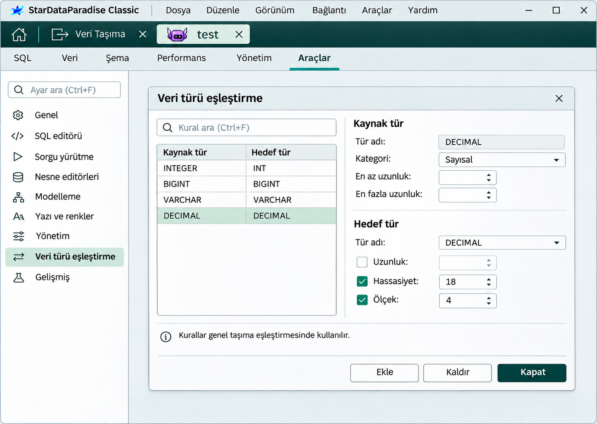

Giriş yolu `Veri Taşıma → Genel tür kuralları`. Genel taşıma tür kurallarını yerel ayarlarda düzenleme.

Görünen komutlar Kaynak tür/kategori, alt/üst uzunluk, hedef tür, uzunluk/hassasiyet/ölçek override, Ekle, Kaldır, Kapat. Ana eylem **Kapat**.

Her override kendi onay kutusuna bağlıdır. Kaynak tip aralıkları ve varsayılan koruma yerel mapping kayıtlarına gider.

[Mevcut kaynak](<C:/Users/Yusuf Salim OZBEK/source/repos/StarDataParadise/out/mysql-workbench-native-src/plugins/migration/frontend/datatype_mapping_editor.py>) · [İlgili canlı inceleme](referanslar/mevcut/16-schema-inspector.jpg)

## 38 · Tablo bakımı

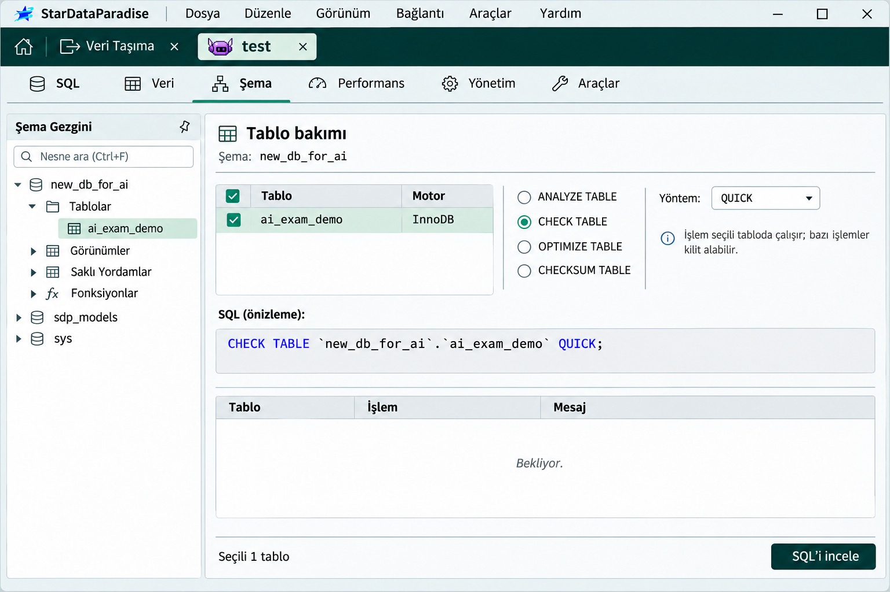

Giriş yolu `Şema → Tablo → Bakım`. Seçili tablolar için bakım komutunu ve seçeneklerini hazırlama.

Görünen komutlar ANALYZE, CHECK, OPTIMIZE, CHECKSUM, yöntem ve motor bazlı seçenekler, çıktı. Ana eylem **SQL’i incele**.

İşlem ve seçenek desteği motor/sürüme göre değişir. Mevcut bakım işlevleri korunur. SQL inceleme ortak yüzeye bağlanır.

[Mevcut kaynak](<C:/Users/Yusuf Salim OZBEK/source/repos/StarDataParadise/out/mysql-workbench-native-src/plugins/wb.sqlide/sqlide_catalogman_ext.py>) · [İlgili canlı inceleme](referanslar/mevcut/18-table-inspector.jpg)

## 39 · Mekânsal veri aktarımı

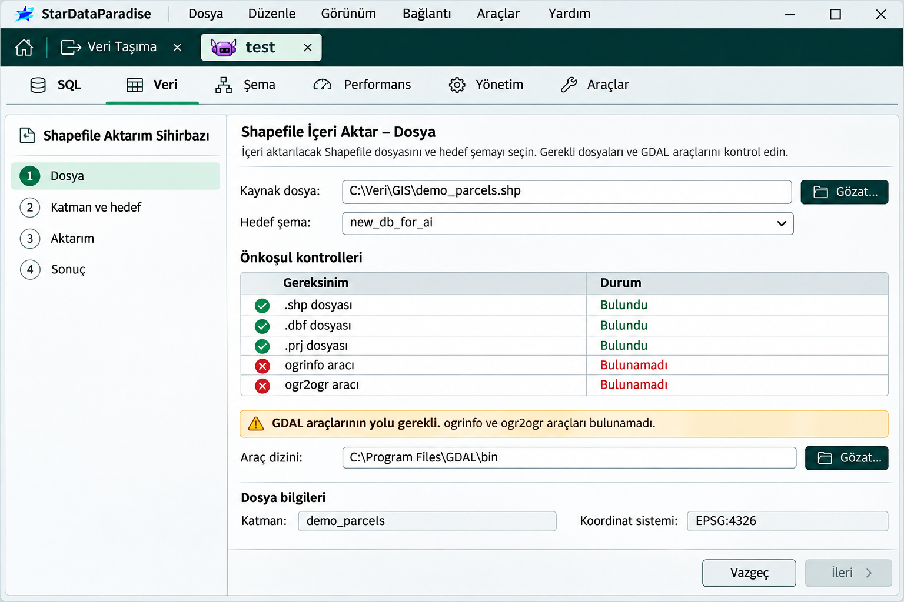

Giriş yolu `Şema bağlam menüsü → Mekânsal veri yükle`. Shapefile ve gerekli GDAL araçlarıyla mekânsal veri aktarımını hazırlama.

Görünen komutlar SHP/DBF/PRJ denetimi, ogrinfo/ogr2ogr, hedef şema, katman, EPSG, alan seçimi, aktarım. Ana eylem **İleri**.

Eksik araç ve eksik dosya durumları kaynakta mevcut. Araç dizini seçimi yeni UI uyarlamasıdır. GDAL yolu doğrulandığında devam edilir.

[Mevcut kaynak](<C:/Users/Yusuf Salim OZBEK/source/repos/StarDataParadise/out/mysql-workbench-native-src/plugins/wb.sqlide/sqlide_import_spatial.py>) · [İlgili canlı inceleme](referanslar/mevcut/16-schema-inspector.jpg)

## 40 · Hücre ve BLOB inceleyicisi

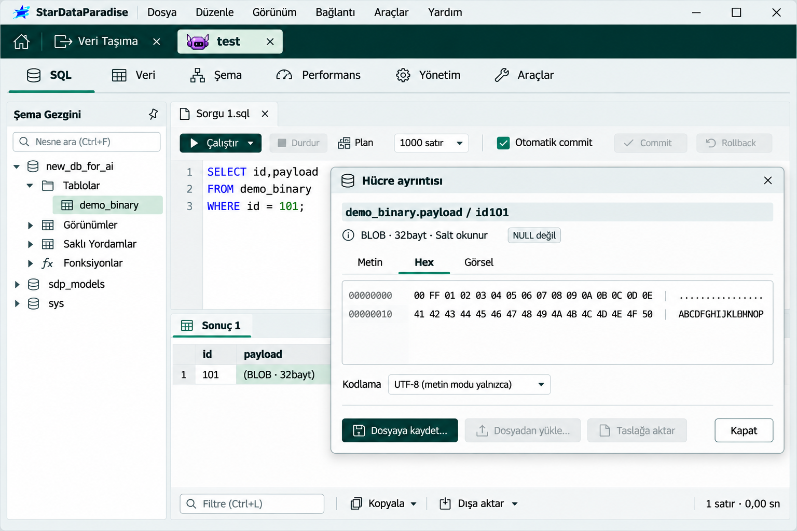

Giriş yolu `Sonuç hücresi → Değeri aç`. Metin, binary ve desteklenen görsel/geometri hücre değerini inceleme.

Görünen komutlar Metin, Hex, Görsel, kodlama, Dosyaya kaydet, Dosyadan yükle, taslağa aktar, Kapat. Ana eylem **Kapat**.

Uzunluk, byte aralığı, NULL/boş değer ve salt okunur gerekçesi görünür. Büyük değerlerde mevcut sayfalama kullanılır.

[Mevcut kaynak](<C:/Users/Yusuf Salim OZBEK/source/repos/StarDataParadise/out/mysql-workbench-native-src/backend/wbpublic/grtui/binary_data_editor.cpp>) · [İlgili canlı inceleme](referanslar/mevcut/24-query-results.jpg)

## 41 · CSV ve JSON dışa aktarma

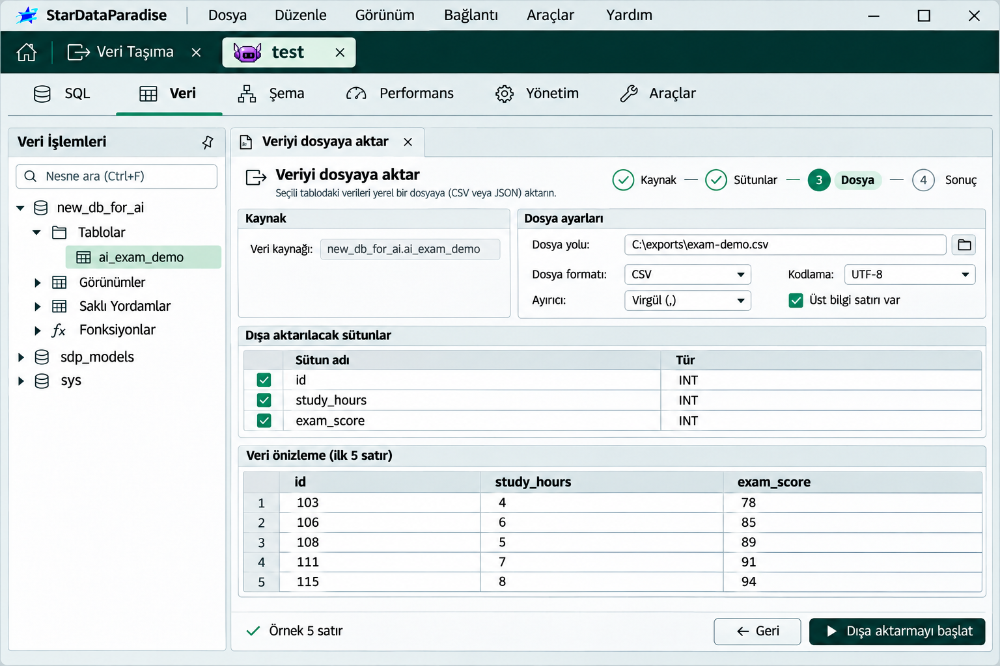

Giriş yolu `Veri → Dosyaya dışa aktar`. Tablo veya sorgu verisini CSV/JSON olarak yerel dosyaya yazma.

Görünen komutlar Kaynak, sütun seçimi, dosya/format/kodlama, ayraç, başlık, önizleme, satır sayısı/offset. Ana eylem **Dışa aktarmayı başlat**.

Mevcut dosya, kodlama, hassas sayı, NULL ve büyük veri davranışı native export motorundan gelir. SQL dump ayrı giriştedir.

[Mevcut kaynak](<C:/Users/Yusuf Salim OZBEK/source/repos/StarDataParadise/out/mysql-workbench-native-src/plugins/wb.sqlide/sqlide_power_export_wizard.py>) · [İlgili canlı inceleme](referanslar/mevcut/24-query-results.jpg)
