# AI, SQL/PLSQL ve HIST - Görsel tasarım galerisi

Bu galeri 35 ayrı ekran ve durum tasarımını içerir. Görseller, mevcut Classic Workbench görüntüleri referans alınarak ImageGen ile üretilmiş **taslaklardır**; sunucu özelliğinin veya çalışır arayüzün tamamlandığı anlamına gelmez. Veriler ve sonuçlar örnektir. Görsellerdeki kod ve küçük metinler uygulama sözleşmesinin yerine geçmez; komut kapsamı için [renklendirme ve IntelliSense envanterine](KOMUT-INTELLISENSE.md) bakın.

**21 Kasım kapsam kararı:** Bu release AI/Knowledge ve SQL/PLSQL ekranlarını kapsar. HIST/SQL git, remote/sync ve yeni kullanıcı SQL JOB tasarımları sonraki etaba ertelendi. Aşağıdaki 23–34 görselleri gelecek tasarım arşividir; bu release arayüzünde HIST sayfası veya Sorgu geçmişi yanında HIST kısayolu bulunmaz. Mevcut Compute araçları bu ertelemeden ayrıdır.

**Başlık ve bilgi ayıracı:** Pencere, modal, sekme ve bilgi özetlerinde iki parça ` - ` ile ayrılır; nokta veya orta nokta ayraç olarak kullanılmaz. Örneğin `Knowledge - Parametreler ve sonuç`. Tarihlerdeki, ondalık sayılardaki ve SQL sözdizimindeki noktalar korunur. Ayrıntılı kural [Classic tasarım kurallarındadır](../KURALLAR.md#renk-ve-tipografi).

## AI ve Stored Knowledge

### 01 - Şema gezgini ve Knowledge tanımı

Gezgine Konuşmalar, Stored Knowledge, Behavior, AI Modelleri ve Yanıt Şemaları eklenir. Seçili Knowledge için Tanım, Parametreler, Bağımlılıklar ve Sürümler sekmeleri; Oluştur, Düzenle, Çalıştır ve Yenile eylemleri bulunur. Tanım SQL/PLSQL tabanlıdır.

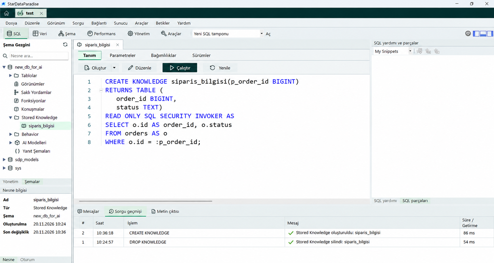

### 02 - Knowledge listesi ve bağlam menüsü

Şemaya göre listeleme ve arama; sağ tıkla Aç, Düzenle, Çalıştır, Bağımlılıkları göster, Yetkiler ve Sil. Silme işlemi bağımlılıklar ve yetkiler doğrulandıktan sonra ayrı incelemeye gider.

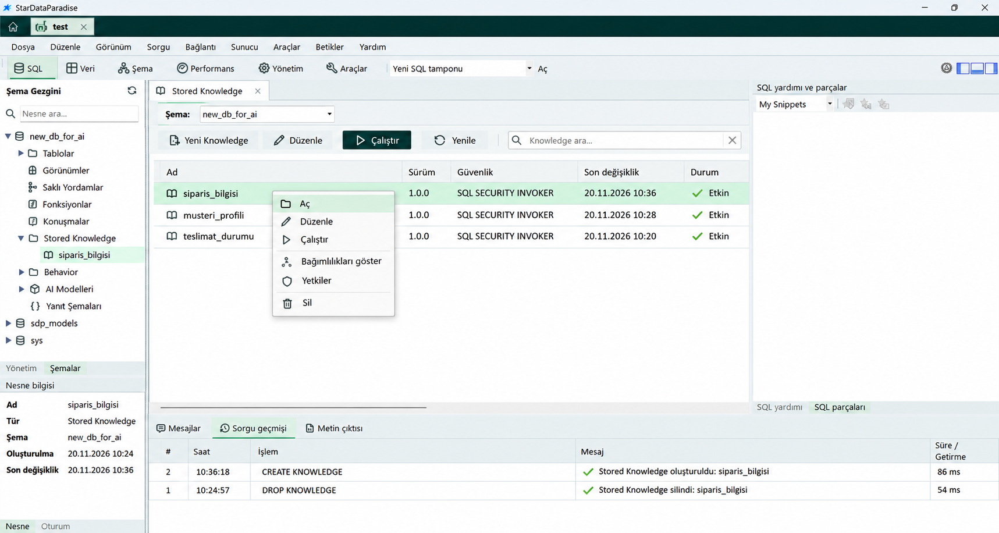

### 03 - Knowledge oluşturma

Ad, şema ve güvenlik seçenekleri ile SQL tanım alanı. Sözdizimini denetle, SQL'i incele ve Vazgeç eylemleri; parametreler, sonuç sütunları ve bağımlılıklar ayrı sekmelerdedir.

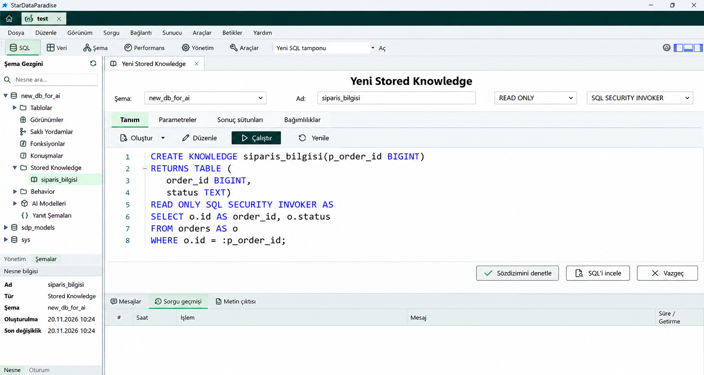

### 04 - Parametreler ve sonuç şeması

Girdi parametreleri ve tipli sonuç sütunları eklenir, değiştirilir veya kaldırılır. READ ONLY ve SQL SECURITY INVOKER seçimi görünür; Kaydet değişiklikleri taslağa taşır.

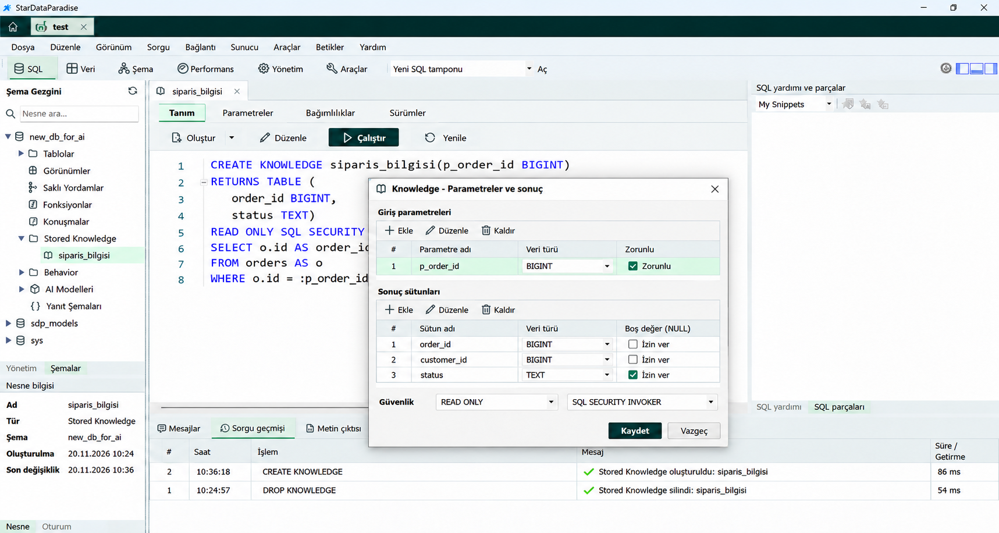

### 05 - Bağımlılıklar ve sürümler

Knowledge ile kaynak tablo, behavior ve model arasındaki ilişkiler yönlü bağlantı diyagramında gösterilir. Sürümler, önceki ve etkin sürümü ayıran yatay zaman çizgisinde yer alır. Doğrula, Sürümü incele, Etkinleştir, Bağımlılık ekle ve Yenile eylemleri seçili nesneye uygulanır.

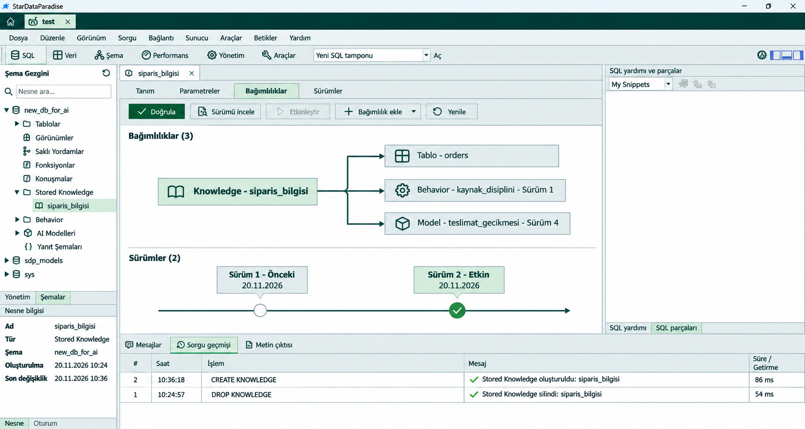

### 06 - Knowledge çalıştırma

Tipli parametre değeri girilir ve sonuç tablosu incelenir. Çalıştırılan Knowledge sonucu tek başına konuşmaya gönderilmez; context'e ekleme ayrı bir işlemdir.

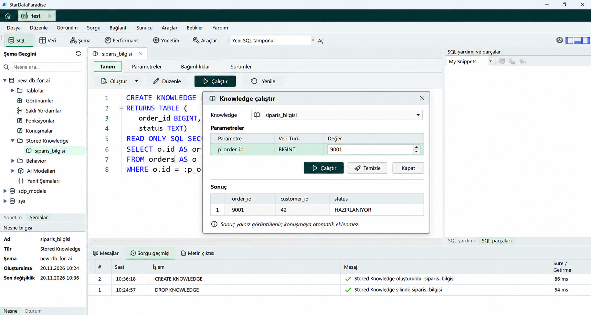

### 07 - Behavior ve sürümleri

Behavior tanımı, sürümleri ve bağlı konuşmalar görüntülenir. Yeni sürüm oluşturma ile konuşma bağlantısını kaldırma ayrı eylemlerdir.

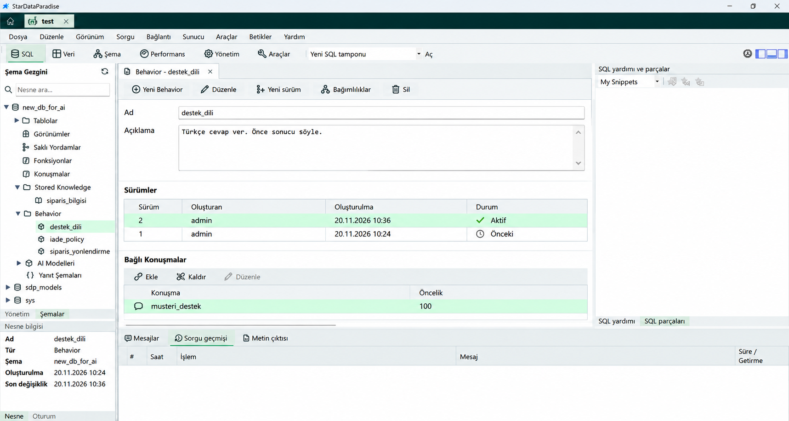

### 08 - Yeni konuşma

Şema, ad, model, WITH/NO FUNCTIONS, AUTO APPEND MESSAGE, bellek kapsamı ve behavior seçimi. Ticket oluşturma sonrasında sunucudan gelir; SQL'i incele, Oluştur ve Vazgeç eylemleri sunulur. İşaretli seçenek oluşturma sonrasında AI SQL sekmesini açar; yalnız sekmeyi açmak komut veya model çağrısı başlatmaz.

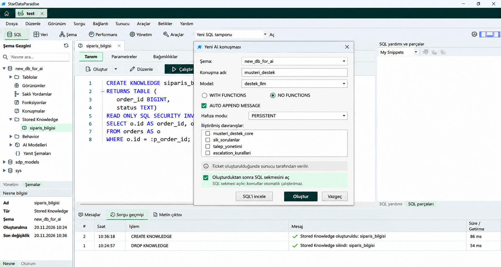

### 08A - Konuşmayı SQL ile çalıştırma

Konuşma oluşturulduktan sonra ayrı `AI SQL - musteri_destek` sekmesi açılır. `START AI CONVERSATION`, `APPEND PROMPT`, `COMMIT` ve `FINISH` editörden çalıştırılır; ticket ile `:question` bağlı değerleri sağda, cevap ve run durumu altta ayrı gösterilir. Çalıştır eylemi kullanıcı tarafından başlatılır.

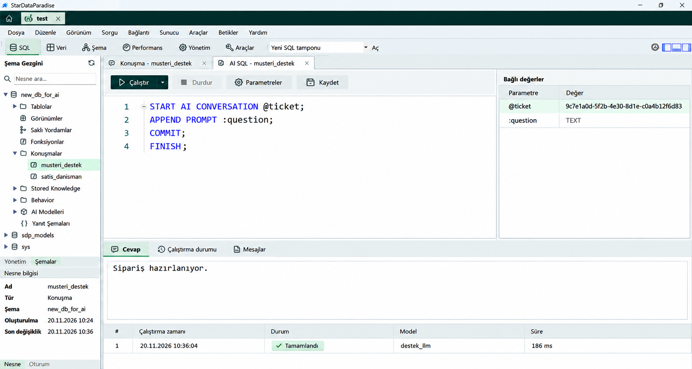

### 09 - Konuşma ve run ayrıntısı

Ticket ve model bilgileri; mesajlar, context, bellek ve çalıştırmalar ayrı sekmelerde yer alır. Başlat, SQL ile çalıştır, Ayarlar, Geçmiş, Arşivle ve seçili run ayrıntısına geçiş gösterilir.

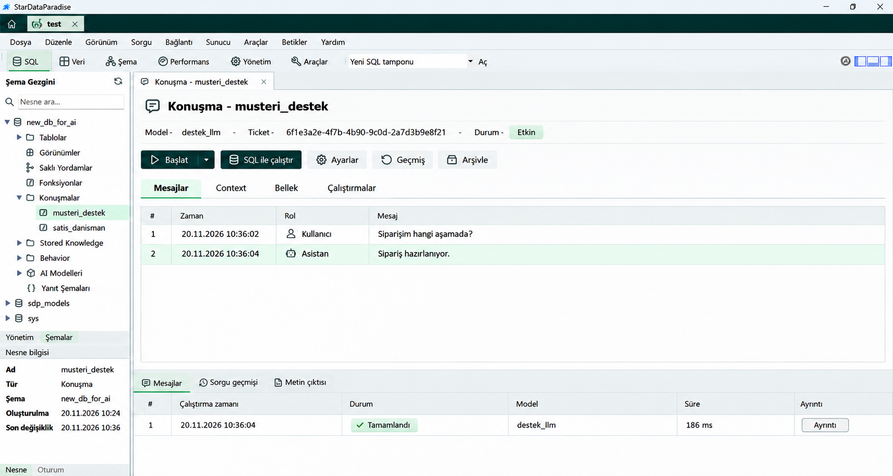

### 10 - Belleği sıfırlama

Kalıcı ve geçici bellek öğeleri ayrı gösterilir. FLUSH MEMORY önizlemesi yeni bellek dönemini açıklar; geçmiş mesajların ve behavior tanımlarının silinmediğini ve değişikliğin commit ile kalıcılaşacağını belirtir.

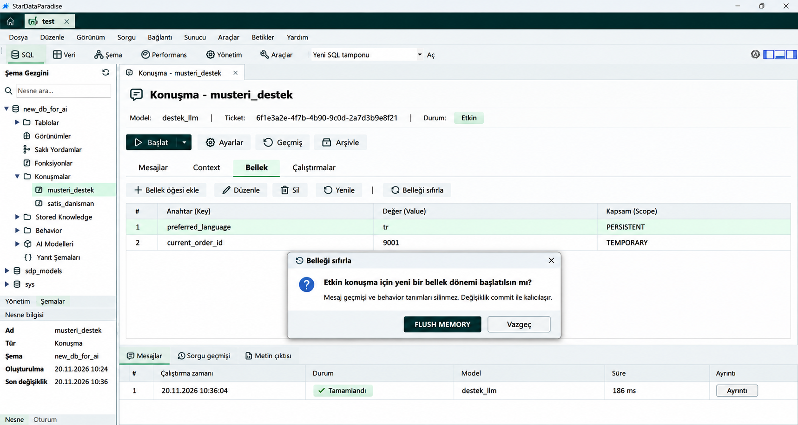

### 11 - Yanıt şeması ve JSON doğrulama

Yanıt şemasını düzenleme, yeni sürüm, doğrulama ve SQL inceleme. Hatalı örnekte altı basamaklı örnek kod, JSON yolu ve Ayrıntı/Kopyala eylemleri gösterilir.

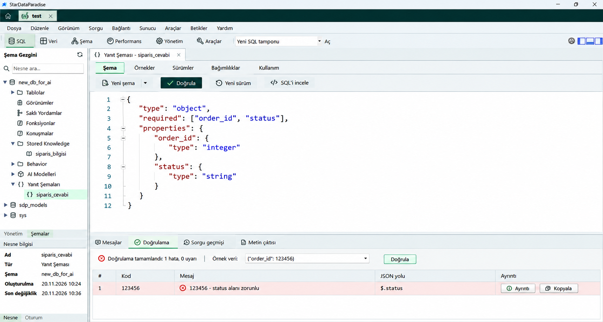

### 12 - Yetki ve onay

Rol bazında EXECUTE ve APPROVE seçimi ile yordam için onay gereksinimi. SQL'i incele, Uygula ve Vazgeç ayrı eylemlerdir; yetki ve onay çalışma anında yeniden doğrulanır.

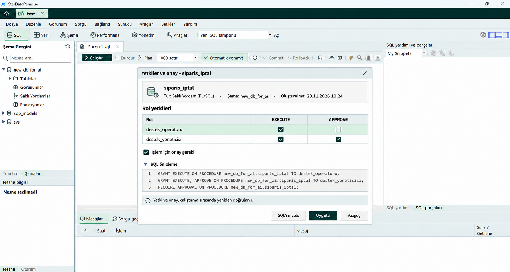

## SQL ve PL/SQL

### 13 - EXCLUDE / REPLACE

Sütun çıkarma ve değiştirme normal SQL editöründe yazılır. Sütun adları ve türleri tamamlama listesinde, EXCLUDE açıklaması sağ yardım alanında görünür.

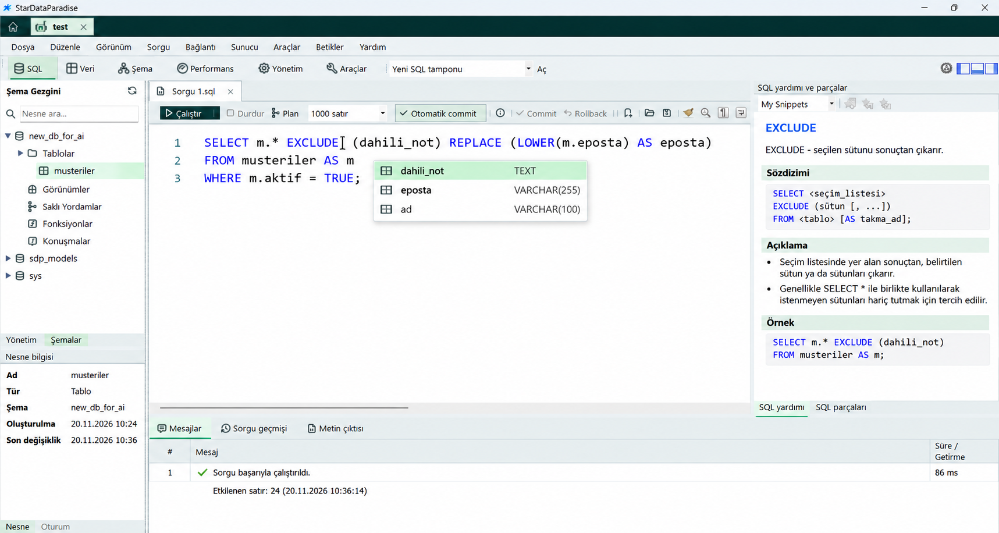

### 14 - QUALIFY

Pencere hesaplamasından sonraki filtreleme gösterilir. ROW_NUMBER, RANK ve DENSE_RANK bağlamsal öneriler, komut açıklaması ve örnek sonuç aynı çalışma alanındadır.

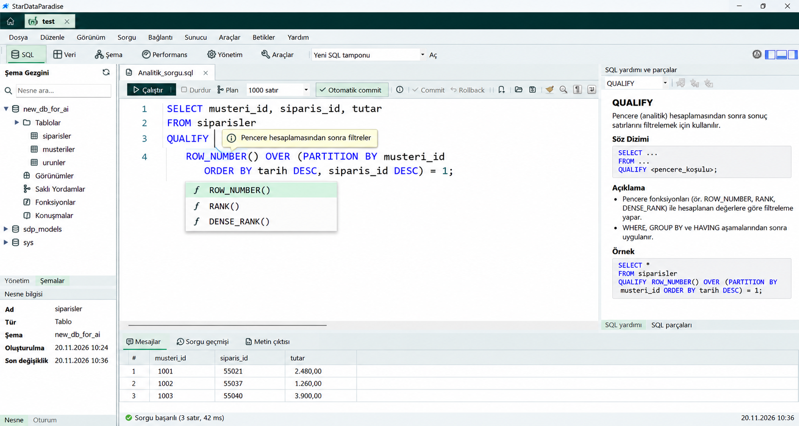

### 15 - Aşamalı sorgu

FROM ile başlayan sorgunun `|>` aşamaları için WHERE, SELECT, ORDER BY ve LIMIT önerileri. Görselde sorgu yazım aşamasındadır; ayrı COMPACT modu yoktur.

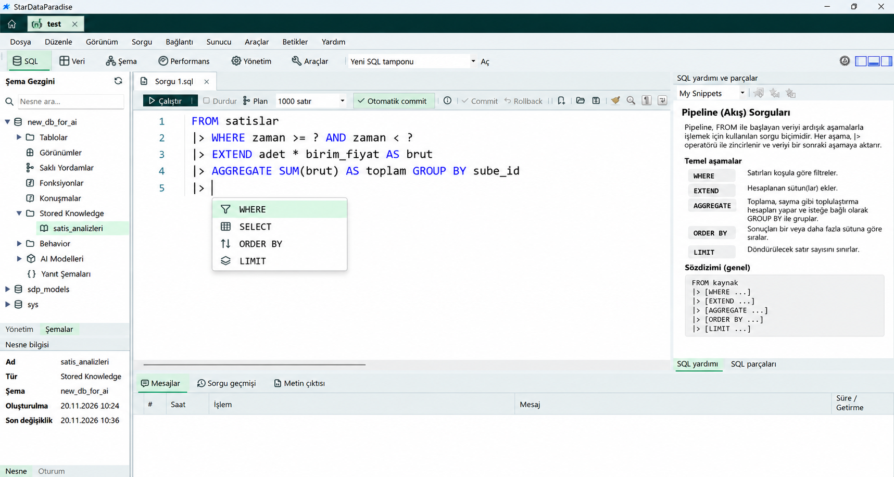

### 16 - INSERT BY NAME

Kaynak çıktı adları ile hedef sütun adları bir pencerede karşılaştırılır. SQL'e dön ve Kapat eylemleri; eşleşmenin sütun sırasına göre yapılmadığını açıklayan not bulunur.

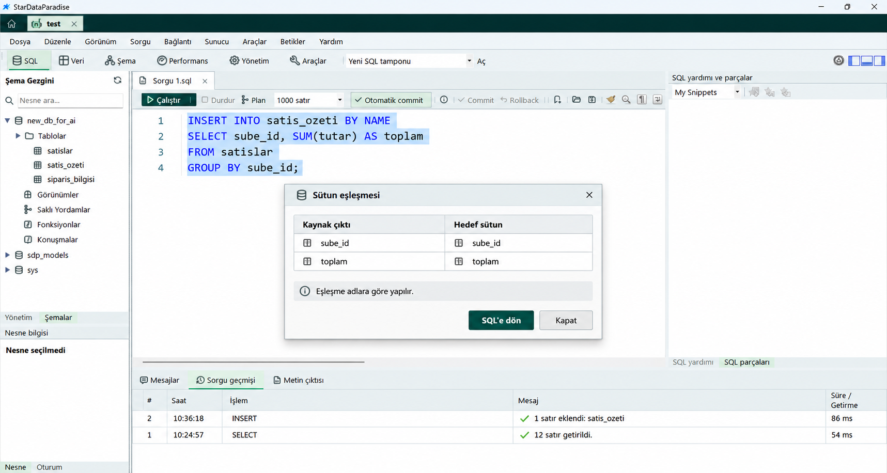

### 17 - LET ve WHEN

Kısa yordam gövdesi, yerel değişken önerisi ve LET/WHEN yardımı. WHEN, DO sonrasındaki tek komutu çalıştırır; SQL içindeki `:adet` açık bağlamadır.

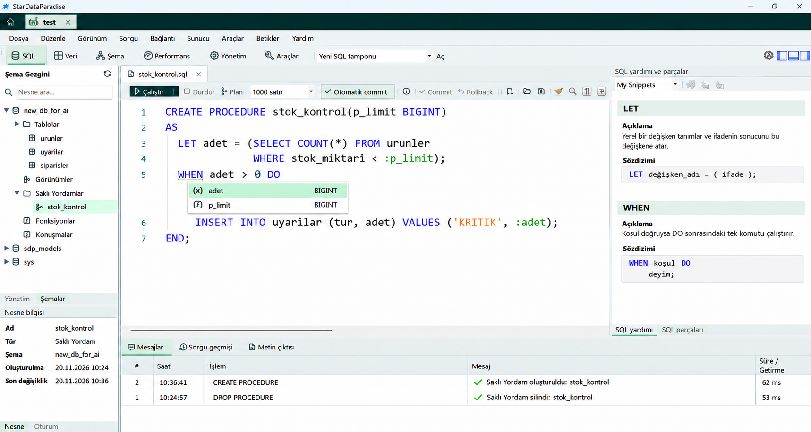

### 18 - Sorgu üzerinde FOR

Saklı yordam editöründe tipli satır değişkeni, SELECT kaynağı ve END FOR sınırı. Sözdizimini denetle, Çalıştır ve SQL'i incele eylemleri görünür.

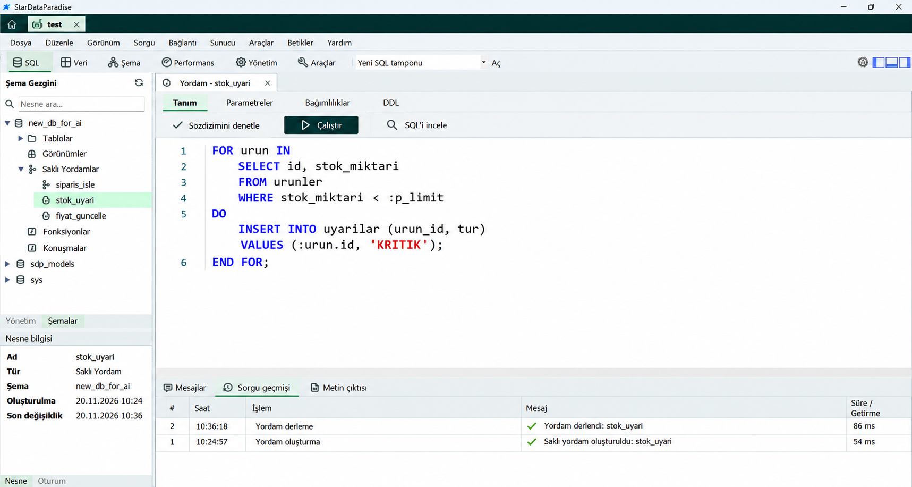

### 19 - Fonksiyon çalıştırma

Fonksiyonun parametresi ve veri türü listelenir; kullanıcı örnek değeri girip sonucu görür. Çalıştır, Temizle ve Kapat ayrı düğmelerdir.

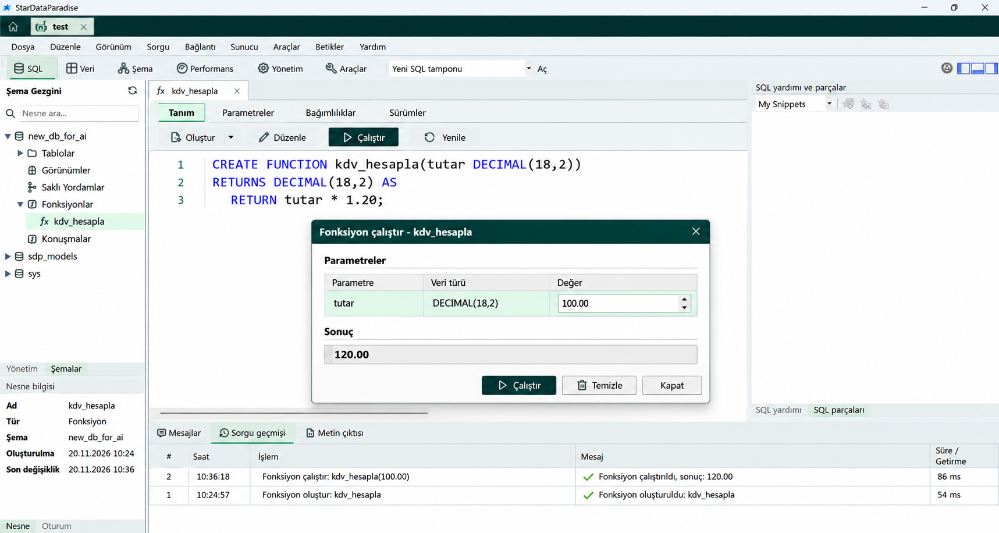

### 20 - SHOW EXPANDED

Yazılan sorgu ve açıklayıcı genişletilmiş gösterim yan yana incelenir. Bu görünüm sorguyu yürütmez; Kopyala, SQL'e dön ve Yenile bulunur.

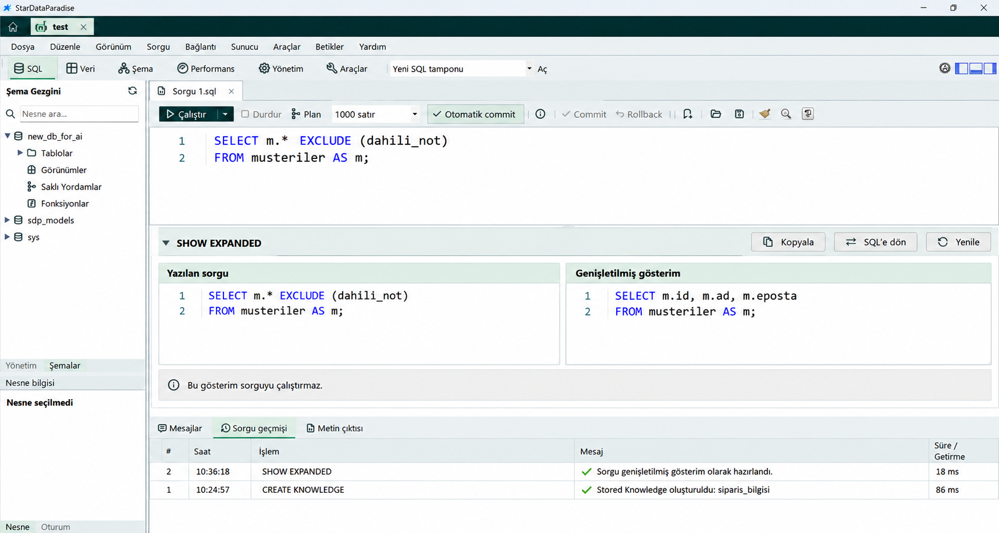

### 21 - Hata ayrıntısı

Kaynak satırında işaretleme ve alt panelde hata; ayrıntı penceresinde düz altı basamaklı örnek kod, aşama, satır ve sütun. Kopyala ve Kapat eylemleri bulunur.

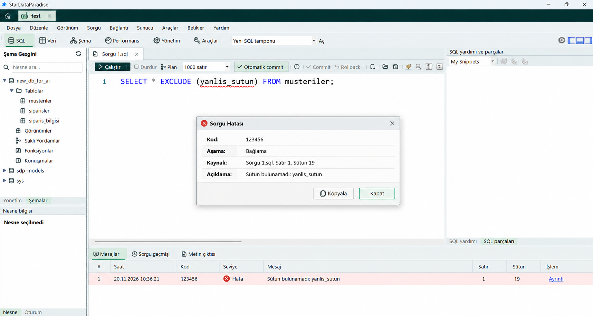

### 22 - Parametre bağlama

Sorgu parametreleri tip ve değerleriyle girilir; Bağla ve çalıştır ayrı işlem olarak sunulur. Tamamlama, parametreleri sütun ve fonksiyonlardan ayırt eder.

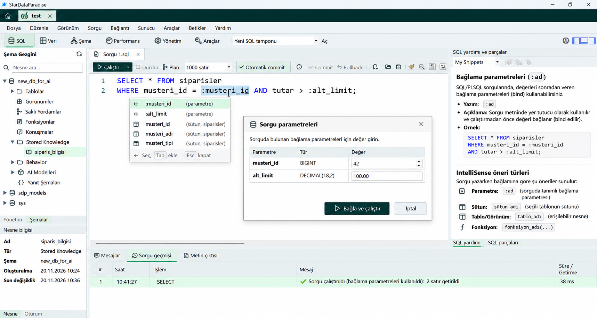

## HIST

### 23 - Alt panel girişi

Sorgu geçmişinin yanındaki HIST sekmesinde son revision'lar, her satıra hizalı bağlı düğümler ve kısa işlem açıklamaları gösterilir. Yenile, Filtre ve Genişlet ile ayrıntılı görünüme geçilir.

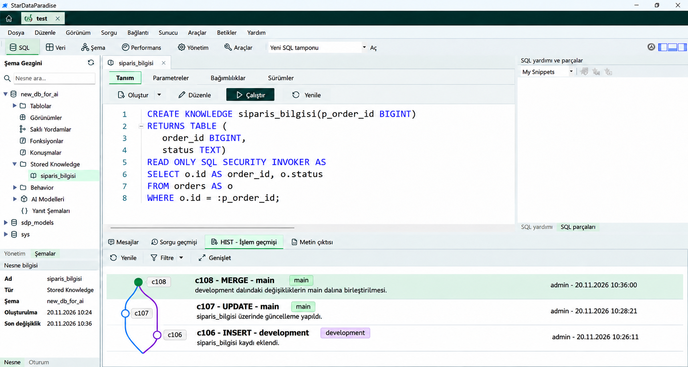

### 24 - Revision ve branch grafiği

Git benzeri bağlı düğümler ve işlem açıklamaları aynı akışta yer alır; dallanma ve birleşme satırlarla hizalıdır. Seçili satır nane yüzeyle ayrılır. Sağda revision ve iki ebeveyni, üstte filtreleme, karşılaştırma ve dal yönetimi bulunur.

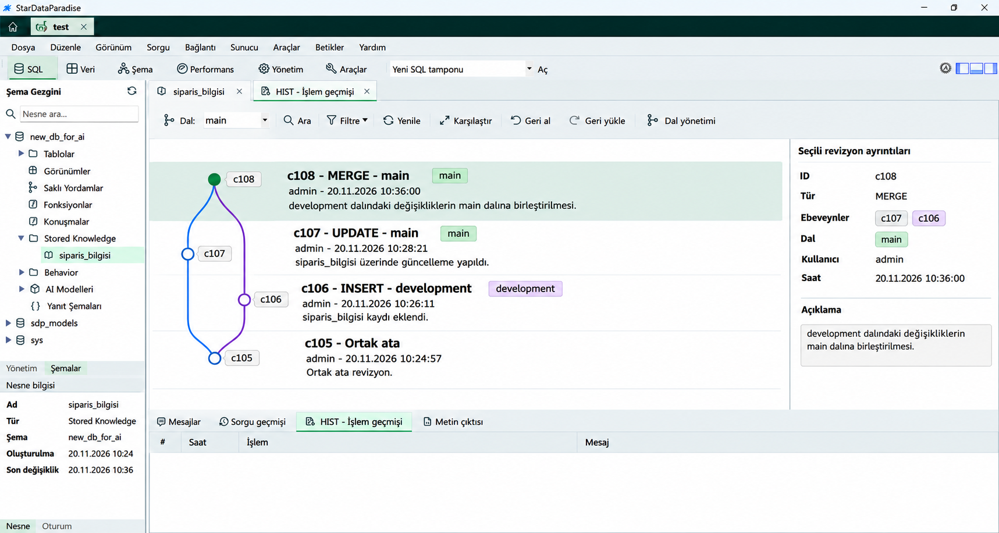

### 25 - Revision ayrıntısı

Transaction kimliği, kullanıcı ve dal ile veri değişiklikleri, bağlı işler, dış etkiler ve kaynak ayrı bölümlerde gösterilir. Farkı göster ve geri alma önizlemesi seçili revision'a yöneliktir.

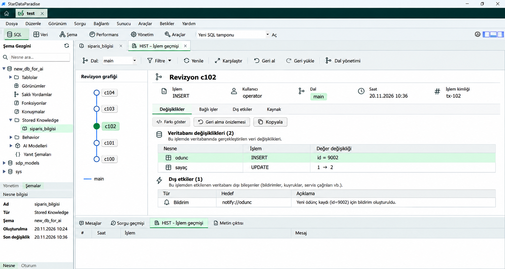

### 26 - Önce / sonra farkı

İki revision arasında seçili satırın alanları karşılaştırılır; değişen tarih vurgulanır. Önceki/Sonraki değişiklik ve Dışa aktar eylemleri bulunur.

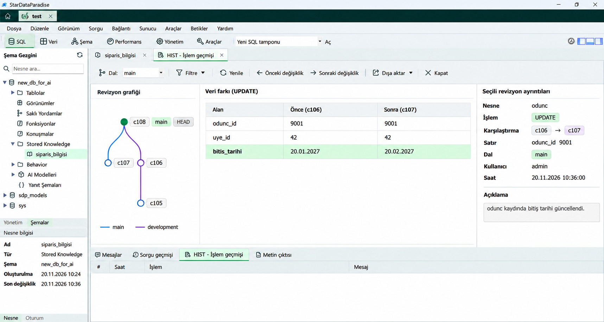

### 27 - REVERT önizlemesi

Mükerrer ödünç kaydının etkileri, sayaç ve bekleyen iş birlikte listelenir; doğru ödünç korunur. Önizleme veri değiştirmez; Uygula öncesinde doğrulama yapılır.

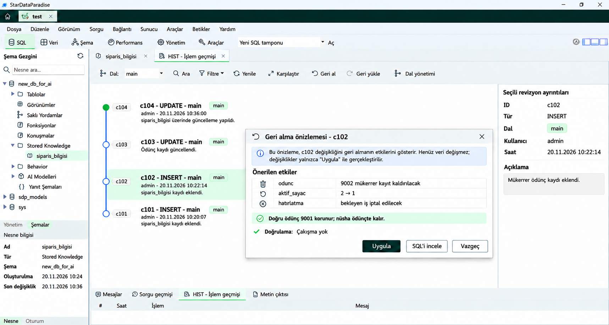

### 28 - RESTORE önizlemesi

Seçilen satırın güncel durumu ile hedef revision'daki durumu karşılaştırılır. Planı doğrula, Uygula ve Vazgeç bulunur. RESTORE, seçili geçmiş duruma getirme işlemidir.

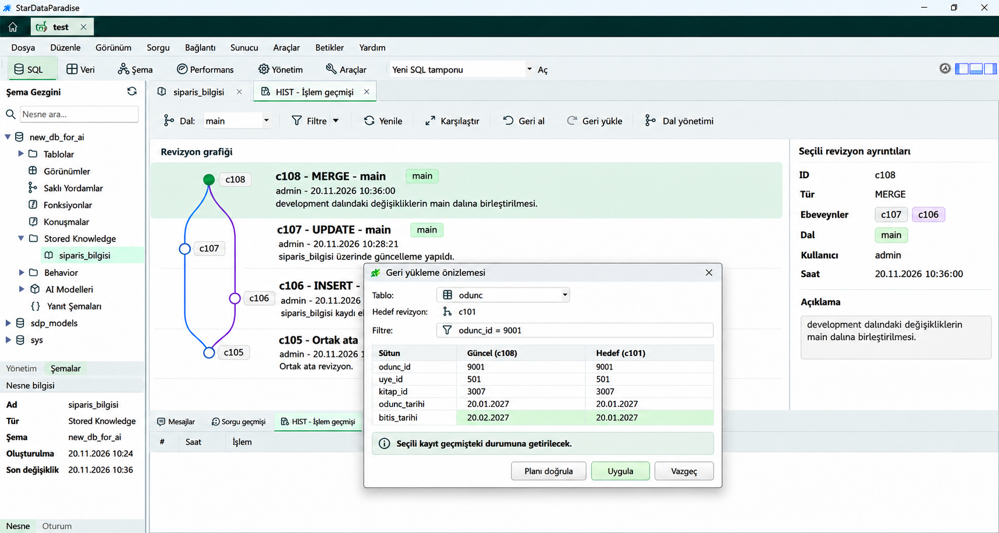

### 29 - Güncelliğini yitiren plan

Kayıt, şema veya yetkiler değişmişse uygulama engellenir. Etkilenen kayıt ve revision'lar gösterilir; kullanıcı yeni önizleme oluşturabilir.

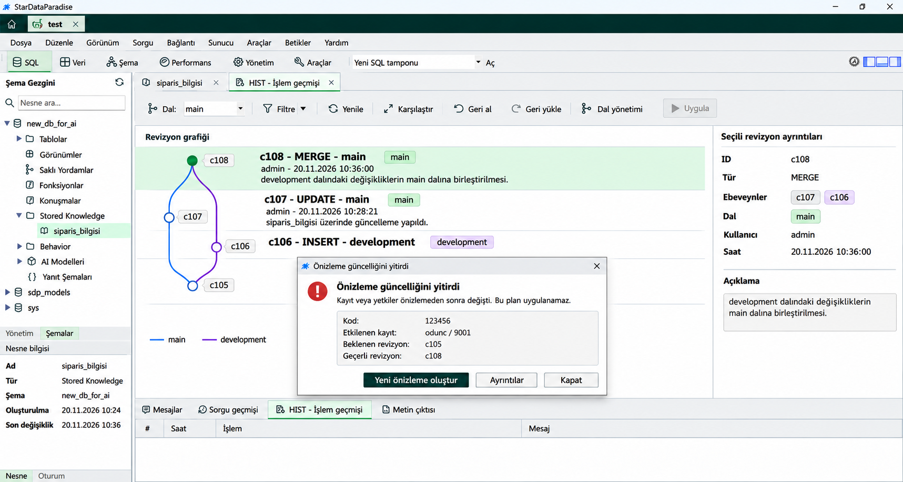

### 30 - Dal ve etiket yönetimi

Mevcut dallar, başlangıç ve uç revision'ları; yeni dal, dala geçme, etiket oluşturma ve silme eylemleri. Dal değişiminin yalnız seçili bağlantıyı etkilediği belirtilir.

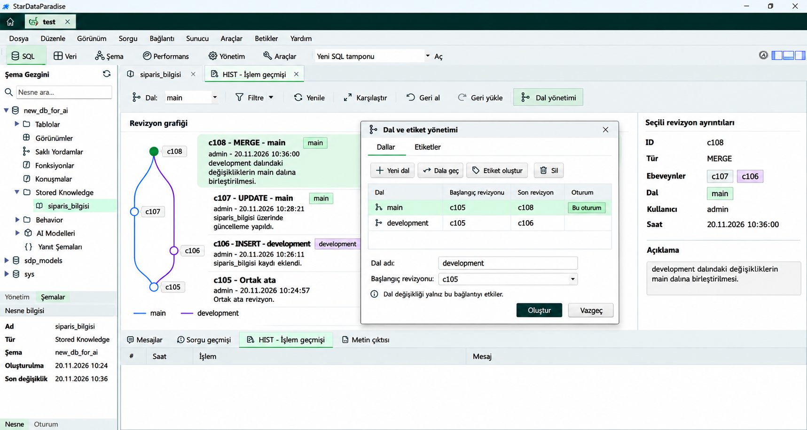

### 31 - Uzak sunucu ve FETCH

Remote adı, uç nokta, kimlik bilgisi başvurusu ve TLS doğrulaması. Bağlantıyı sına ve FETCH; uzak geçmişi almanın yerel canlı veriyi değiştirmediği açıklamasıyla gösterilir.

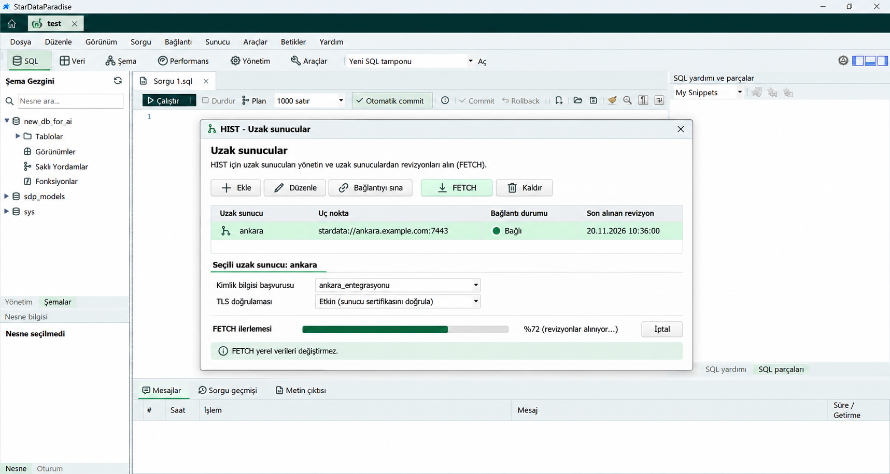

### 32 - Üç yönlü merge

Ortak ata, yerel hedef ve uzak kaynak değerleri yan yana incelenir. Yerel, uzak veya özel değer seçimi ve yeniden doğrulama vardır. Tüm çakışmalar çözülüp plan doğrulanmadan hiçbir değişiklik uygulanmaz.

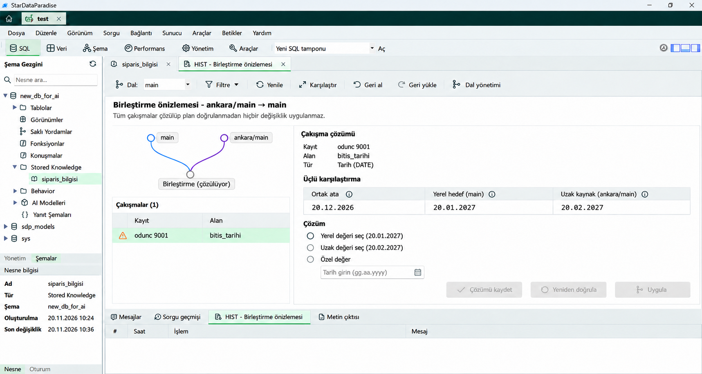

### 33 - Sync ve JOB

Yön, aralık, durum, son revision ve run bilgileri; Başlat, Duraklat, Devam et, Durdur ve Ayrıntı. Çakışmada ilgili ilişki durur ve çakışma çözülmeden otomatik yeniden denenmez. BACKOFF birimi saniyedir.

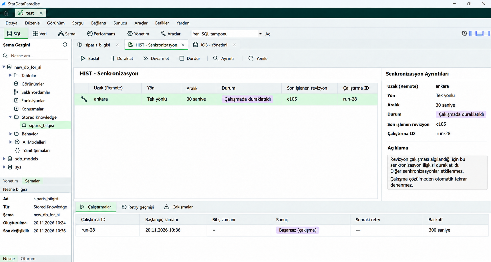

### 34 - Olay akışı

Olay kimliği ve revision ile veritabanı commit durumu ve uygulamanın işleme durumu ayrı gösterilir. Abonelik, son ACK, devam konumu ve süresi dolan cursor uyarısı görünürdür.

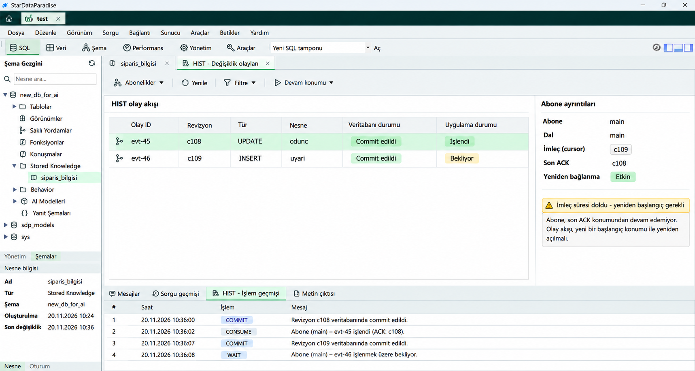

## Teslim notları

- Görsellerin çoğu 1717×916 piksel, yatay masaüstü oranındadır; tasarım referansıdır ve canlı ekran görüntüsü değildir.
- Görsellerdeki örnek başarı, işlem, kullanıcı ve hata kodları temsili verilerdir. `123456` tahsis edilmiş gerçek bir hata kodu iddiası değildir.
- Önceki denemeler `onceki-taslaklar/` altında veya aynı klasördeki eski sürüm adlarıyla korunur. Bu galeri seçilmiş 35 son görseli kullanır.
- Ortak görsel çerçeve ve ekran istemleri [PROMPTLAR.md](PROMPTLAR.md) dosyasındadır.
